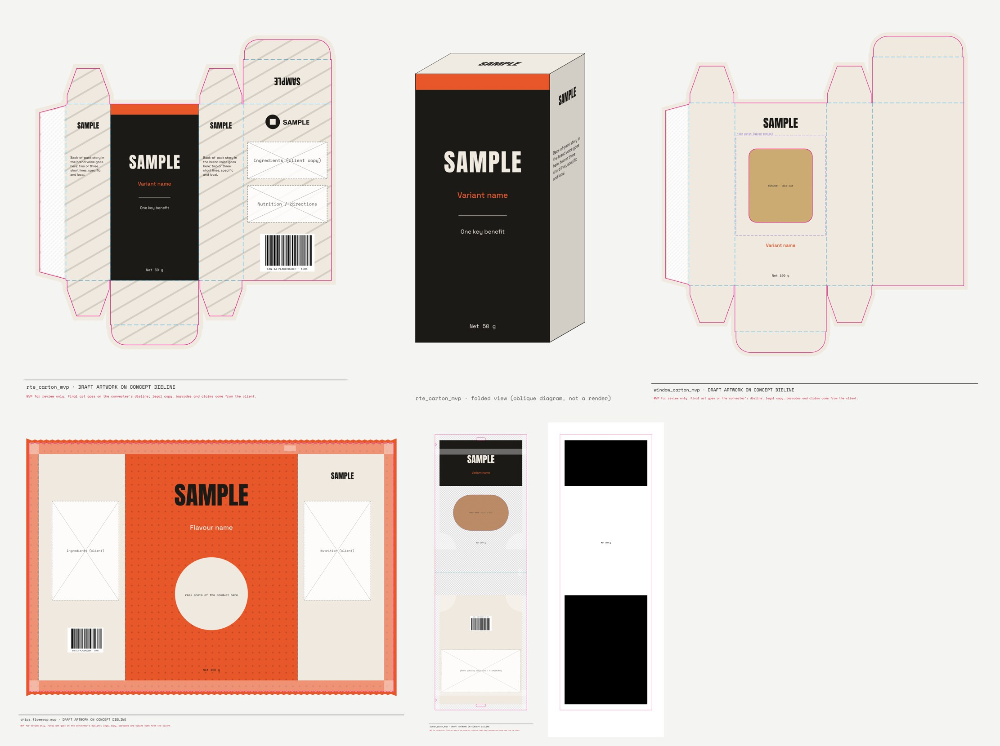
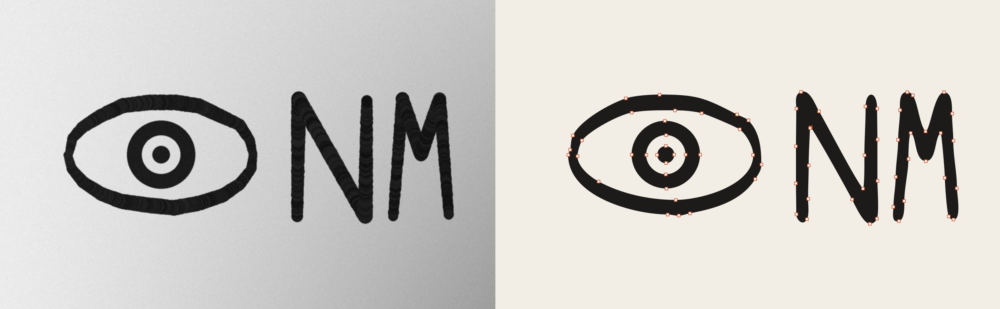

# nazar-studio

> A design studio's brain, hands and toolbox, in folders. The ideas are Nazar's. Claude is the extra pair of hands that never gets tired of redrawing a dieline at 2 a.m.

**nazar-studio** is a set of [Claude Code](https://claude.com/claude-code) skills from Nazar, a creative studio run by Kaif Nathani. It doesn't replace a designer. It works like a very fast, very fussy studio assistant: it asks before it draws, reads old archives instead of scrolling trends, runs real engines (not image generators), and checks its own work before you see it.

**Your prompt leads.** Every kit is an add-on: Claude pulls the pieces your request needs (a rule, a checklist, an engine) and skips the rest.

1. **Asks first.** Every question comes up front, each with options and a recommended pick.
2. **Researches properly.** It reads manuals, archives, standards and primary sources, and every claim comes with a source.
3. **Builds with engines.** Python that draws dielines, traces sketches, lays out packs and outlines type, with outputs you can measure.
4. **Nitpicks before you do.** Automatic QA on every output, and Claude looks at every image itself.

No AI slop, no stock photos, no "elevate your journey". AI imagery is used only when a client says yes in writing.

---

## What it can do

### 📦 Draw real dielines from three numbers


`nazar-dieline/engine/dieline.py`: give it the inside dimensions (L × W × D) and the board, and it draws a **concept dieline**.

- **Formats:** layered SVG, PDF, PNG, a **DXF** that opens in CAD (with CUT / CREASE / PERF / GLUE layers), and a spec sheet.
- **14 structures:** ECMA tuck ends, sleeve, glued tray, FEFCO 0201 / 0200 / 0427, pillow, rigid set-up box (blank plus wrap with turn-ins), cone and wrap labels, stand-up pouch, chips flow-wrap, and a shrink-sleeve map.
- **Spec sheet:** flat size, board area, cut and crease rule length (which drives die cost), rough nesting per sheet, and a McKee compression estimate for corrugated.
- **Engineering:** caliper allowances, friction locks, tapered glue flaps, corner reliefs, and grain arrows.
- **Testing:** every DXF passes a CAD audit with zero errors.

### 🎨 Draft the pack design *on* the structure


Add an `"art"` block and the engine lays out an **MVP pack**, panel by panel.

- **The right way up when folded.** Tucks, lids and bottoms rotate automatically.
- **Real brand assets:** brand tokens, outlined fonts (harfbuzz), the client's exact logo file, bands, patterns that run across folds, and placeholders for copy and the GS1 barcode at true size.
- **Folded oblique preview** of the pack.
- **Transparency handled for real:**
  - A carton window becomes a die-cut hole plus the film patch.
  - Clear and metallised film get "no ink, no white" windows, a **white-ink plate**, and a preview in the product's own colour.
  - Chips packets get the fin seal, serrated crimps and the back art split across the web.
- **Automatic draft QA:** type size in pt, contrast measured against what's actually behind the text, copy overflow, barcode size and fit, net quantity in the bottom 30% of the principal panel, art on the glue flap, windows too close to creases or seals, and light-sensitive snacks behind windows.
- **Send it to Figma:** `--figma` writes a step-by-step build plan for [claude-talk-to-figma-mcp](https://github.com/arinspunk/claude-talk-to-figma-mcp). Upright panels arrive as editable layers and text, and the dieline as a locked layer. The setup guide covers a pinned, localhost-only install for any user's Claude: [`nazar-dieline/FIGMA.md`](nazar-dieline/FIGMA.md).

### ✍️ Sketch on paper, get clean vectors


`nazar-core/engine/trace.py`: **hands first.** Kaif draws, the machine cleans up.

1. **Clean the photo:** flatten the uneven light, threshold it automatically, despeckle.
2. **Find the corners:** checked at two scales, and pinned so smoothing can't round them off.
3. **Place nodes on the true extremes,** where the curve is really horizontal or vertical, the way a professional vector artist would.
4. **Fit the curves:** Schneider least-squares Béziers, giving a single SVG path with holes kept.

You get three variants (tight, balanced, smooth), a compare sheet and a node report. `--levels 3` traces shaded drawings into recolourable tone layers for package art. It needs only numpy and Pillow, and it's MIT-clean.

### 🖋️ Draw like a hand, in code


`nazar-illustration/engine/ink.py`: illustration that behaves like a pen, not a filter.

- **Pressure strokes:** filled outlines that taper at the ends.
- **Smooth paths, real corners:** centripetal Catmull–Rom splines through hand-placed points, with only slow, low-frequency wobble.
- **Tone from marks:** nested hatching (four tones) and Poisson-disk stipple.
- **Print look:** flats misregistered like real printing, plus ink density and paper grain.
- **Concept first:** every illustration starts with a one-sentence idea, a focal point, a light direction and a budget.
- **Honest about limits:** for complex scenes, Claude also hands you a ready image prompt (used only with client approval).

### 🧠 The whole studio, as one floor

Think of `nazar-studio` as a real studio floor, not a toolbox: a front desk, a think tank, a few drawing boards, a production floor, and a door it all goes out through — with one shared brain (`nazar-core`) that every desk reads from. A job doesn't walk every desk; Claude reads the brief and only pulls the ones it needs.

| Desk | Kit | Does |
|---|---|---|
| Front desk | `nazar-pitch` | Proposals, pricing, contracts, feedback |
| Think tank | `nazar-strategy` | Positioning, names, taglines with an edge |
| Drawing board | `nazar-logo` | Marks: 100 thumbnails → the blur test → every export file |
| Drawing board | `nazar-illustration` | Drawing in code: spot art, icons, patterns, pen-and-ink, math art |
| Drawing board | `nazar-type` | Font sourcing, licensing, Urdu/Nastaliq pairing |
| Drawing board | `nazar-colour` | Palettes from archives and craft, print-safe, contrast-checked |
| Bindery | `nazar-brand-book` | The identity system and the book (with hidden things to find) |
| Production floor | `nazar-dieline` | Structures, real dielines, MVP pack drafts, Figma bridge |
| Production floor | `nazar-packaging` | Packs that win the shelf in 2 seconds and print without drama |
| Mailroom (client-approved only) | `nazar-prompts` | AI image/video prompts, used only with written sign-off |
| Out the door | `nazar-social` | Feed-native systems, reels, launch grids, the slop test |
| Out the door | `nazar-backdrops` | A year of routine-post backdrops, dark and light, every format |
| Out the door | `nazar-ooh` | Billboards, walls, vehicles, screens that read in one breath |
| Out the door | `nazar-motion` | Logos that move like they mean it |
| Out the door | `nazar-web` | Brand sites that are fast, accessible, a little bit extra |
| Out the door | `nazar-art-direction` | Photo briefs, illustration guides, icon grids |
| The brain (everywhere) | `nazar-core` | Research method, taste, QA, the renderer, sketch → vector |

## Install (30 seconds, 0 drama)
```bash
git clone https://github.com/Kaifrizwan12/nazar-studio.git
cp -R nazar-studio/nazar-* ~/.claude/skills/
pip install -r nazar-studio/nazar-core/engine/requirements.txt     # engines: numpy, Pillow, CairoSVG, harfbuzz, fontTools
```
Keep the kits side by side, since they all read `nazar-core`. For a single project, copy them into `.claude/skills/` in that repo instead, and drop `CLAUDE.md` in the root.

## Use
Open your project in Claude and say what you need, or paste a ready-made prompt from [`PROMPTS.md`](PROMPTS.md):
> *"A tuck-end carton for a 60 × 30 × 120 mm tea tin, then three pack routes drafted on it. Sober, one pop colour."*

Then answer the questions. It'll take it from there, and it'll show its homework.

**Extend it for your product:** the engines are plain Python. [`nazar-dieline/EXTENDING.md`](nazar-dieline/EXTENDING.md) tells your Claude how to add a structure, a design block or a QA check, and how to test it.

## About Kaif
**Muhammad Kaif Nathani** is a brand and art director. He makes identities and brand books for food, FMCG, tech, studios and services, and this repo is how he works, written down so Claude can work that way too.

He runs **Nazar**, a Karachi studio that plans the street and the feed as one campaign.

- **Archive before algorithm.** Every choice comes from something real: a 1970s manual, a hand-painted shop board, a bus route map, a crate label. If he can't show the client where an idea came from, it doesn't make the cut. He goes looking for inspiration; he doesn't wait for the feed to serve it.
- **Sober, then a wink.** His pages are calm, use one accent and leave a lot of air. Somewhere on page 47 there's a detail that only makes sense the second time you look.
- **Desi at heart, cinematic at eye level.** He loves hand-painted signs, wedding-card type, film title cards and end credits, all set on a strict grid. Loud colour goes on quiet pages, never everywhere.
- **Allergic to "elevate your journey".** If you could swap the logo and the line still works, the line is dead. He writes twenty, says them out loud on the street, and keeps the three that make someone smirk.
- **Hands first.** AI can help the hands, but it never replaces the brain.

His preferences live in [`nazar-core/references/kaif.md`](nazar-core/references/kaif.md). Fork the repo, swap in your own taste, and the whole studio follows. (Keep the wink, though. He'd want that.)

### The founder's note


## Credits
Method and taste by **Kaif Nathani** / Nazar. Standing on the shoulders of Vignelli, Rand, Rams, Müller-Brockmann, Aicher, Crouwel, Games, Gill, Bass, Albers and a lot of very patient archivists. Fonts in `nazar-core/engine/fonts` are SIL OFL (licences included).

Made with two eyes open. 👁️👁️
