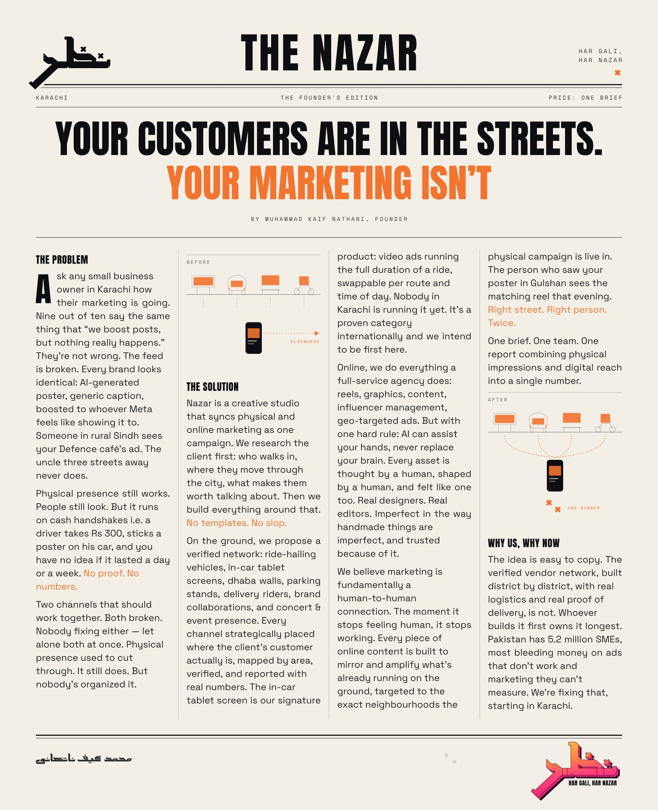

# nazar-studio 

> A whole design studio, in folders. It asks before it draws, reads old archives instead of scrolling trends, and won't let a widow sneak into a headline.

**nazar-studio** is a set of [Claude Code](https://claude.com/claude-code) skills from Nazar, a creative studio run by Kaif Nathani. Drop it in, describe a brand, and Claude works the way a fussy, archive-obsessed, slightly cheeky studio would:

1. **Asks first.** Questions come up front, each with options and a recommended pick.
2. **Researches properly.** It goes to old manuals, crate labels, street lettering and real maps. Trend blogs come last.
3. **Thinks in ideas.** Every route gets one sentence of meaning before any pixels.
4. **Builds, then nitpicks.** About 90 QA checks catch the gap under the heading before you do.

No AI slop, no stock photos, no cartoon mockups, and no "elevate your journey".

## What's in the box
| Kit | Does |
|---|---|
| `nazar-core` | The brain everything shares: the profile, research path, ideation, masters' practices, QA, the renderer |
| `nazar-strategy` | Positioning, names, taglines that actually have an edge |
| `nazar-logo` | Marks, from 100 thumbnails to the blur test to every export file |
| `nazar-brand-book` | The identity system and the book (with hidden things to find) |
| `nazar-packaging` | Packs that win the shelf in 2 seconds and print without drama |
| `nazar-social` | Feed-native systems, reels, launch grids, the slop test |
| `nazar-backdrops` | Brand book in, a year of routine-post backdrops out: dark and light, every format |
| `nazar-ooh` | Billboards, walls, vehicles and screens that read in one breath |
| `nazar-motion` | Logos that move like they mean it |
| `nazar-web` | Brand sites that are fast, accessible and a little bit extra |
| `nazar-art-direction` | Photo briefs, illustration guides, icon grids |
| `nazar-pitch` | Proposals, pricing, contracts, feedback (and how to survive it) |

## Install (30 seconds, 0 drama)
```bash
git clone https://github.com/Kaifrizwan12/nazar-studio.git
cp -R nazar-studio/nazar-* ~/.claude/skills/
```
Keep the kits side by side, since they all read `nazar-core`. For a single project, copy them into `.claude/skills/` in that repo instead, and drop `CLAUDE.md` in the root.

## Use
Open your project in Claude and say what you need, or paste a ready-made prompt from [`PROMPTS.md`](PROMPTS.md):
> *"Brand book for a neighbourhood coffee roaster. Bilingual. Make it sober, but let it wink."*

Then answer the questions. It'll take it from there, and it'll show its homework.

## About Kaif
**Muhammad Kaif Nathani** is a brand and art director. He makes identities and brand books for food, FMCG, tech, studios and services, and this repo is how he works, written down so Claude can work that way too.

He runs **Nazar**, a Karachi studio that plans the street and the feed as one campaign.

- **Archive before algorithm.** Every choice comes from something real: a 1970s manual, a hand-painted shop board, a bus route map, a crate label. If he can't show the client where an idea came from, it doesn't make the cut. He goes looking for inspiration; he doesn't wait for the feed to serve it.
- **Sober, then a wink.** His pages are calm, use one accent and leave a lot of air. Somewhere on page 47 there's a detail that only makes sense the second time you look.
- **Desi at heart, cinematic at eye level.** He loves hand-painted signs, wedding-card type, film title cards and end credits, all set on a strict grid. Loud colour goes on quiet pages, never everywhere.
- **Allergic to "elevate your journey".** If you could swap the logo and the line still works, the line is dead. He writes twenty, says them out loud on the street, and keeps the three that make someone smirk.
- **Hands first.** AI can help the hands, but it never replaces the brain.

His preferences live in [`nazar-core/references/kaif.md`](nazar-core/references/kaif.md). Fork the repo, swap in your own taste, and the whole studio follows. (Keep the wink, though. He'd want that.)

### The founder's note



## Credits
Method and taste by **Kaif Nathani** / Nazar. Standing on the shoulders of Vignelli, Rand, Rams, Müller-Brockmann, Aicher, Crouwel, Games, Gill, Bass, Albers and a lot of very patient archivists. Fonts in `nazar-core/engine/fonts` are SIL OFL (licences included).

Made with two eyes open. 👁️👁️
