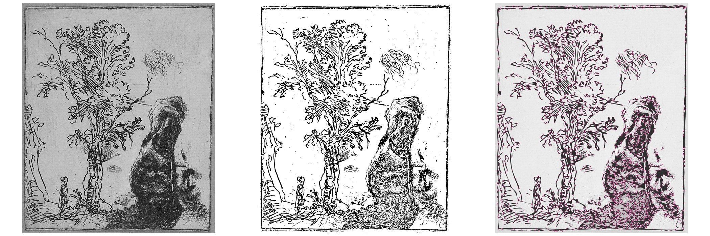

# nazar-studio

> A design studio's brain, hands and toolbox, in folders. The ideas are Nazar's. Claude is the extra pair of hands that never gets tired of redrawing a dieline at 2 a.m.

**nazar-studio** is a set of [Claude Code](https://claude.com/claude-code) skills from Nazar, a creative studio run by Kaif Nathani. It doesn't replace a designer. It works like a very fast, very fussy studio assistant: it asks before it draws, reads old archives instead of scrolling trends, runs real engines (not image generators), and checks its own work before you see it.

**Your prompt leads.** Every kit is an add-on: Claude pulls the pieces your request needs (a rule, a checklist, an engine) and skips the rest.

1. **Asks first.** Every question comes up front, each with options and a recommended pick.
2. **Researches properly.** It reads manuals, archives, standards and primary sources, checks claims against them, and flags openly what it couldn't confirm instead of guessing.
3. **Builds with engines.** Python that draws dielines, traces sketches, lays out packs and outlines type, with outputs you can measure.
4. **Nitpicks before you do.** Automatic QA on every output, and Claude looks at every image itself.

No AI slop, no stock photos, no "elevate your journey". AI imagery is used only when a client says yes in writing.

<table>
<tr>
<td width="33%"><a href="#-draw-real-dielines-from-three-numbers"></a><br><sub><b>Dielines</b> from three numbers</sub></td>
<td width="33%"><a href="#-sketch-on-paper-get-clean-vectors"></a><br><sub><b>Etching → vector</b>, fine-line mode</sub></td>
<td width="33%"><a href="#-your-pattern-not-the-machines"></a><br><sub><b>Your pattern</b>, not the machine's</sub></td>
</tr>
<tr>
<td width="33%"><a href="#-your-pattern-not-the-machines"></a><br><sub><b>One engine per trade</b>, tested blind</sub></td>
<td width="33%"><a href="#-your-pattern-not-the-machines"></a><br><sub><b>Real photographs</b>, 24 CC0, read blind</sub></td>
<td width="33%"><a href="#-a-palette-from-real-archive-work-then-checked"></a><br><sub><b>Palettes</b> from real archives, checked</sub></td>
</tr>
<tr>
<td width="33%"><a href="#-type-qa-on-real-font-files"></a><br><sub><b>Type QA</b> on real fonts, incl. real Urdu</sub></td>
<td width="33%"><a href="#-archive-colour--brand-tokens--backdrops"></a><br><sub><b>Archive → tokens → backdrops</b></sub></td>
<td width="33%"><a href="#-your-pattern-not-the-machines"></a><br><sub><b>Can the engines tell designers apart?</b> 35 real prints, blind, with the misses shown</sub></td>
</tr>
<tr>
<td colspan="3"><a href="#-five-more-kits-run-on-real-work"></a><br><sub><b>Five more kits</b> run on real work: packaging, out-of-home, social, web, motion</sub></td>
</tr>
</table>

---

## What it can do

### 📦 Draw real dielines from three numbers


`nazar-dieline/engine/dieline.py`: give it the inside dimensions (L × W × D) and the board, and it draws a **concept dieline**.

- **Formats:** layered SVG, PDF, PNG, a **DXF** that opens in CAD (with CUT / CREASE / PERF / GLUE layers), and a spec sheet.
- **14 structures:** ECMA tuck ends, sleeve, glued tray, FEFCO 0201 / 0200 / 0427, pillow, rigid set-up box (blank plus wrap with turn-ins), cone and wrap labels, stand-up pouch, chips flow-wrap, and a shrink-sleeve map.
- **Spec sheet:** flat size, board area, cut and crease rule length (which drives die cost), rough nesting per sheet, and a McKee compression estimate for corrugated.
- **Engineering:** caliper allowances, friction locks, tapered glue flaps, corner reliefs, and grain arrows.
- **Testing:** every DXF passes a CAD audit with zero errors.

### 🎨 Draft the pack design *on* the structure


Add an `"art"` block and the engine lays out an **MVP pack**, panel by panel.

- **The right way up when folded.** Tucks, lids and bottoms rotate automatically.
- **Real brand assets:** brand tokens, outlined fonts (harfbuzz), the client's exact logo file, bands, patterns that run across folds, and placeholders for copy and the GS1 barcode at true size.
- **Folded oblique preview** of the pack.
- **Transparency handled for real:**
  - A carton window becomes a die-cut hole plus the film patch.
  - Clear and metallised film get "no ink, no white" windows, a **white-ink plate**, and a preview in the product's own colour.
  - Chips packets get the fin seal, serrated crimps and the back art split across the web.
- **Automatic draft QA:** type size in pt, contrast measured against what's actually behind the text, copy overflow, barcode size and fit, net quantity in the bottom 30% of the principal panel, art on the glue flap, windows too close to creases or seals, and light-sensitive snacks behind windows.
- **Send it to Figma:** `--figma` writes a step-by-step build plan for [claude-talk-to-figma-mcp](https://github.com/arinspunk/claude-talk-to-figma-mcp). Upright panels arrive as editable layers and text, and the dieline as a locked layer. The setup guide covers a pinned, localhost-only install for any user's Claude: [`nazar-dieline/FIGMA.md`](nazar-dieline/FIGMA.md).

### ✍️ Sketch on paper, get clean vectors


`nazar-core/engine/trace.py`: **hands first.** Kaif draws, the machine cleans up.

1. **Clean the photo:** flatten the uneven light, threshold it automatically, despeckle.
2. **Find the corners:** checked at two scales, and pinned so smoothing can't round them off.
3. **Place nodes on the true extremes,** where the curve is really horizontal or vertical, the way a professional vector artist would.
4. **Fit the curves:** Schneider least-squares Béziers, giving a single SVG path with holes kept.

**Hairlines and engraving: `--fine`.** A global threshold loses lines under ~2 px and the despeckle step erased what was left, so a Rembrandt etching traced to noise. `--fine` upscales, uses a *local* threshold (darker than its own neighbourhood) and skips the opening step; the same etching (CC0, The Met) now keeps its tree, figure and hatching. It stays noisy in the darkest shadow, so raise `--min-area` to drop dust. Plain mode is still right for bold marker and pencil. You get three variants (tight, balanced, smooth), a compare sheet and a node report. `--levels 3` traces shaded drawings into recolourable tone layers for package art. It needs only numpy and Pillow, and it's MIT-clean.

### 🖋️ Draw like a hand, in code


`nazar-illustration/engine/ink.py`: illustration that behaves like a pen, not a filter.

- **Pressure strokes:** filled outlines that taper at the ends.
- **Smooth paths, real corners:** centripetal Catmull–Rom splines through hand-placed points, with only slow, low-frequency wobble.
- **Tone from marks:** nested hatching (four tones) and Poisson-disk stipple.
- **Print look:** flats misregistered like real printing, plus ink density and paper grain.
- **Concept first:** every illustration starts with a one-sentence idea, a focal point, a light direction and a budget.
- **Honest about limits:** for complex scenes, Claude also hands you a ready image prompt (used only with client approval).

### 🫆 Your pattern, not the machine's


**Every AI has a pattern, and everyone can smell it now.** `nazar-voiceprint` pulls *yours* out of the work you made before AI, checks it with you, and hands any AI a file that makes your pattern win over its own.

Drop an archive: a decade of office `.docx` files, a director's scripts, a reel-maker's old scripts, an illustrator's portfolio. You get back **THE PATTERN**, one portable file for Claude, ChatGPT or Gemini.

| Layer | What it reads | Engine |
|---|---|---|
| **Words** | Rhythm (mean *and* spread), punctuation, paragraphing, function-word lean, and the **signature phrases that recur across your documents** (your openers, pivots, sign-offs) | `analyze.py` |
| **Story** | Where your turns land, dialogue cadence, refrains, code-switching, frame breaks, reel pacing from *your own* catalogue | guided read + `analyze.py` |
| **Visual** | Palette habit, air and balance; colour grading and effects; an illustrator's strokes; a designer's grid and type scale; a photographer's camera habits; an editor's cutting rhythm; how people are posed; style modes and reused elements across a portfolio | `portfolio.py` runs them all |

**How it works:**
1. **Pre-AI filter.** `ingest.py` reads every document's real creation date and holds back anything from after 30 Nov 2022, so your pattern doesn't learn a chatbot's. You decide what goes back in.
2. **Habit vs. genre.** Every feature is tested across the whole archive and marked *habit*, *varies* or *document-driven*. Only habits make it into the pattern. Research on cross-genre idiolect is mixed, so it's tested, never assumed.
3. **Confirm loop.** You get about ten plain statements to say yes or no to, plus *your* never list ("I'd never write *please don't hesitate to reach out*. I'd write *shout if anything looks off*"). Motifs and intent come from you; the research is clear that software can't extract them.
4. **Override-grade output.** The pattern opens with a precedence block, carries real quoted exemplars, pairs every "never" with a "do instead", and makes the AI **draft → check → revise** and re-anchor on your exemplars every few paragraphs, because style drifts back to the model's default the longer it writes.
5. **Test drive.** It writes a sample, measures its *own* output with the same engine, and fixes what fails. In the demo, a Hinglish monologue for an engineering student who secretly loves design went from *"short, flat, even"* (an AI's default cadence) to matching the target rhythm. Then a Hindi-Urdu function-word baseline, built from 1M words of real subtitles, caught a register miss the rhythm couldn't: the draft told a story where the pattern *argues* (*yaar, arey, kyon, na*). Four passes, every one measured. Reading: [`examples/tamasha_pattern.md`](nazar-voiceprint/examples/tamasha_pattern.md).

The demo pattern was read from a famous monologue (*Tamasha*, 2015). Only numbers and short fragments are kept; the script isn't redistributed. A real job profiles **your own** archive. It's honest about the ceiling: 2025–26 research shows prompted style still sits a measurable step away from true authorship, so you get a strong first draft in your voice, not a clone. Built on Mosteller & Wallace, Burrows' Delta, Biber, STRAP, Gatys and Cinemetrics; the citations are in [`nazar-voiceprint/references`](nazar-voiceprint/references).

**The result: an original scene, written to the extracted pattern** (not a scene from any film):

```
[Hostel room. Laptop ki light.]
Compile / Run / Submit.
Ek aur assignment... ek aur green tick... bas? Bas green tick, yaar?
Ammi ne poocha tha, "khush ho?" Khush...? Maine kaha CGPA 8.4 hai. Unhone dobara poocha. Maine phir... CGPA bataya. Kya karta? Aur kya hota hai batane ko?
(camera ki taraf) Arey, aap bhi poochoge? Mat poochna na... jawab wahi hai.
Compile / Run...
Desktop pe ek folder hai. Naam? Misc. Misc mein kya hai? Kuch nahin. Arey, kuch... nahin... bas teen saal ke poster... ek chai waale ka logo jo usne kabhi lagaya hi nahin... fest ka mascot jiski aankhein maine teen raat tak theek ki thi... aur ek font jo sirf apne naam ke liye banaya tha, kyunki koi font mere naam jaisa lagta hi nahin tha...
Kuch nahin.
Second year mein ek ladka tha jo raat bhar ye sab banata tha... subah lecture mein so jaata tha, aur phir bhi pata nahin kaise sabse zyada khush wahi rehta tha... Professor ne kaha, "beta, ye hobby hai." Papa ne kaha, "isse ghar nahin chalta." Seniors ne kaha, "placement mein koi nahin poochta." Ladke ne suna... achcha ladka tha... sunta tha. Usne folder ka naam badal ke misc rakh diya.
Smart move, hai na? Magar misc koi nahin kholta...
Compile / Run / Submit.
Error...
Error? Kyun yaar...? Code to sahi hai... line 42... unexpected indent...
(hasi) Unexpected. Haan. Sab kuch expected tha... bas ye nahin tha.
(mouse misc pe ruk jaata hai)
Double click...? Nahin yaar. Kal viva hai.
...
Single click hi sahi na...?
[Folder khulta hai. Screen rangon se bhar jaati hai.]
Compile... nahin. Aaj nahin.
```

#### One engine per creative trade, each tested blind


Every engine was checked against the truth before it was trusted: original work built with a **known** style, then read blind. The orange text on the card is what the engines concluded, untouched. The tests caught real bugs on the way: content mistaken for a grade, skeleton spurs, a float rounding error. Each one was fixed, not hidden.

| Trade | Engine | What it reads |
|---|---|---|
| Colourist, photographer | `grade.py` | Look stats, colourfulness, split-toning, faded or crushed blacks, roll-off, vignette, grain, softness, bloom, with labels tagged *measured* or *folklore*. It describes the transform, never a film stock (Yedlin's Display Prep Demo) |
| Illustrator | `strokes.py` | Skeleton → strokes: length, straightness, taper, pressure swing, loose ends (searching vs. confident line) |
| Graphic designer | `layout.py` | Alignment, columns, margins, type scale matched to named modular scales, type vs. image share. No OCR needed |
| Photographer | `exif_habits.py` | Focal length, aperture, shutter, flash and orientation habits across a shoot |
| Editor, director | `video.py` | Cuts, median and distribution of shot lengths (Salt, Cinemetrics), pace, 1/f rhythm (Cutting 2010), grade across shots |
| Anyone who poses people | `pose.py` | Facing, contrapposto, hands, crop point, headroom, from 2D keypoints (after Impett & Moretti's *Totentanz*) |
| Whole portfolio | `cluster.py` | Style modes (most creatives have 2–3) and elements reused across pieces |
| Designer, illustrator | the **VLM pass** (`views.py` + a researched protocol) | Everything numbers can't find: a hidden second image in the negative space, hands drawn as mittens, a recurring joke, how type sits in the image |

Rerun every test yourself: [`examples/make_genre_demos.py`](nazar-voiceprint/examples/make_genre_demos.py).

#### For designers and illustrators: numbers find the measurable part, then Claude *looks*
Graphic design and illustration are full of patterns no engine measures. So the kit directs a vision model with a researched protocol instead of letting it free-associate:
- **`views.py`** builds the views a VLM needs: a squint test, greyscale, a 4-colour flat, an edge map, five full-detail crops, and a contact sheet of the whole body of work. Vision models are weak at fine detail and counting (*Vision language models are blind*, 2024), so they get crops and the engines do the counting.
- **Open discovery first** (list everything that recurs, no taxonomy), then **lenses with sources**: Morelli's habitual minor details (the method behind Ginzburg's *Clues*), Wölfflin's five pairs, Kress & van Leeuwen's grammar of visual design, McCloud's closure and abstraction, Gestalt figure-ground, plus studio lenses for subject, the wink, type-and-image, edges, texture, rhythm and frames.
- **Evidence or it doesn't count:** every claim names a piece and a crop, a habit needs **≥3 pieces**, nothing is attributed to another artist, and *why* is asked of the maker, never guessed.
- **A real run on ten public-domain cyanotypes:** [`examples/vlm_pass_cyanotypes.md`](nazar-voiceprint/examples/vlm_pass_cyanotypes.md). It finds the isolation, the caption convention and the hand-spaced arrangements, and refuses to claim three things a loose description would have: the process look, the museum's photography, and a "style" that was actually two makers.
- **Can the engines tell designers apart? Yes for some, no for others, and the card shows which.**


Hide one print, learn each designer from the rest, name the maker: **60% against 37% for always guessing the biggest group and 25% for chance**, on 35 real CC0 prints. Steinlen (10/13) and Chéret (6/9) have a consistent measurable look. Lautrec (2/7) doesn't: his works span flat-colour posters, a pale line print and a dark black-and-white stage poster, so the engine sees three modes, not one hand. That's the right answer, and it's why the VLM pass and the maker's confirmation exist. Credits are in [`cma_credits.json`](nazar-voiceprint/examples/cma_credits.json). Every print was reviewed by eye, and `fetch_cma_designers.py` uses an approved allowlist so nothing unreviewed can slip in.

#### Then on real photographs


Synthetic tests prove the maths; real work proves the use. 24 public-domain (CC0) photographs from The Met, grouped by the process **each object's own catalogue record names**, and the engine never sees that label. Cyanotypes come out blue, single-hue and soft; albumen and salted paper come out as warm-toned prints. It can't yet separate albumen from salted paper, and autochrome grain needs full-resolution scans, and the card says so. The real test also caught a bug the synthetic one hid: blue cyanotypes on warm paper were being named "teal & orange". Fixed, retested, and the synthetic teal-and-orange grade is still caught. Credits for every image are in [`met_credits.json`](nazar-voiceprint/examples/met_credits.json). Every photo was checked by eye before use, and `fetch_met.py` is paced and backs off politely.

### 🎨 A palette from real archive work, then checked


`nazar-colour/engine/palette_check.py` does what the colour kit promises: archive images in, palette out (k-means in OKLab), then every pair checked.

- **Contrast:** WCAG 2 ratios, with a verdict per pair. The maths is verified against published values (black on white is 21:1; `#777` on white is 4.48:1, the classic near-miss).
- **Colour-blind:** protan, deutan and tritan simulation (Machado, Oliveira & Fernandes 2009); flags any pair that collapses for a viewer.
- **Greyscale:** pairs that depend on hue alone.
- **Honest on APCA:** deliberately not used, because its place in WCAG 3 is unresolved as of April 2026.

Real archive colour is often *worse* than a designed palette: in this one, only 1 of 10 pairs carries body text. That's the finding, not a flaw, and it's why the kit checks before it ships.

### 🔤 Type QA on real font files


`nazar-type/engine/type_check.py` runs the type kit's own checklist on real font files: licence and embedding as the file declares them, coverage per script (Latin, transliteration, pack symbols, Urdu, Sindhi, Devanagari), whether the Arabic-script shaping features exist, kerning, and the **smallest size at which the x-height reaches the 1.2 mm EU rule**. Then a real shaped Urdu line goes through each font, so you can *see* what coverage means. It found real things: none of the studio's own fonts has the **₨ sign**; **Gulzar** sets Urdu beautifully but covers only 4 of 15 Sindhi letters, and needs 7.7 pt for a legal x-height against 4.6 pt for Anton; and Gulzar's file doesn't carry its licence text, so the OFL file from its repository must be filed beside it (confirmed from the source: OFL 1.1). Coverage % says nothing about whether the shapes are good, and the card says so.

### 🧩 Archive colour → brand tokens → backdrops


Three kits chained on real work: ten CC0 cyanotypes → `nazar-colour` → `nazar-backdrops`. Real data exposed two engine bugs, both fixed: the backdrops engine **offered light mode whatever the accent contrast** (here 1.02:1, invisible), and role assignment picked a mid-blue "secondary" at **1.55:1**, so the handle text vanished. Roles are now assigned **by contrast** (`derive_tokens`), and a mode is skipped when its accent is invisible. The archive supports a dark set only, and it says so. The mark is the example brand's placeholder, left unaltered on purpose: **client logos are never recoloured or redrawn**.

### 🧰 Five more kits, run on real work


Each of these kits had no engine. Each now has a small one, built on sources and tested on real work:
- **Packaging** (`nazar-dieline`): real art on a real structure, with the pack engine's own QA checking the *art*: safe area, contrast, type size, missing logo files. The first run caught three real problems.
- **Out-of-home** (`nazar-ooh/ooh_check.py`): letter height from the sign-engineering rule (MUTCD: 30 ft of reading distance per inch; Clearview 40), eye-chart geometry, contrast and read time. The "7 words" rule and the "6 seconds" are **unsourced industry folklore**, and the engine labels them that way. Viewing distance and speed are inputs, because no authoritative figure exists.
- **Social** (`nazar-social/social_lint.py`): the slop test as code: stock phrases, "not just X but Y", triads, em-dashes, emoji, hashtags. A hit is a prompt to rewrite, never proof of anything.
- **Web** (`nazar-web/web_audit.py`): lang, title, viewport, headings, alt text, layout shift, oversized images, link text, WCAG contrast. No network or rendering, so real-device speed still needs Lighthouse.
- **Motion** (`nazar-motion/motion_check.py`): measures *slow in and slow out* (Thomas & Johnston's principle) from a clip: peak speed against end speed, duration and holds. It separates linear (1.2×) from eased (4.8×) and recovers the exact timing. It measures; it doesn't prescribe durations, because no authoritative norms were verified.

### 🧠 The whole studio, as one floor

Think of `nazar-studio` as a real studio floor, not a toolbox: a front desk, a think tank, a few drawing boards, a production floor, and a door it all goes out through — with one shared brain (`nazar-core`) that every desk reads from. A job doesn't walk every desk; Claude reads the brief and only pulls the ones it needs.

| Desk | Kit | Does |
|---|---|---|
| Front desk | `nazar-pitch` | Proposals, pricing, contracts, feedback |
| Think tank | `nazar-strategy` | Positioning, names, taglines with an edge |
| Drawing board | `nazar-logo` | Marks: 100 thumbnails → the blur test → every export file |
| Drawing board | `nazar-illustration` | Drawing in code: spot art, icons, patterns, pen-and-ink, math art |
| Drawing board | `nazar-type` | Font sourcing, licensing, Urdu/Nastaliq pairing |
| Drawing board | `nazar-colour` | Palettes from archives and craft, print-safe, contrast-checked |
| Bindery | `nazar-brand-book` | The identity system and the book (with hidden things to find) |
| Production floor | `nazar-dieline` | Structures, real dielines, MVP pack drafts, Figma bridge |
| Production floor | `nazar-packaging` | Packs that win the shelf in 2 seconds and print without drama |
| Drawing board | `nazar-voiceprint` | Your pattern from your own archive (words, story, visual), overriding any AI's default style |
| Drawing board (sign-off required) | `nazar-prompts` | AI image/video prompts, used only with written client sign-off |
| Out the door | `nazar-social` | Feed-native systems, reels, launch grids, the slop test |
| Out the door | `nazar-backdrops` | A year of routine-post backdrops, dark and light, every format |
| Out the door | `nazar-ooh` | Billboards, walls, vehicles, screens that read in one breath |
| Out the door | `nazar-motion` | Logos that move like they mean it |
| Out the door | `nazar-web` | Brand sites that are fast, accessible, a little bit extra |
| Out the door | `nazar-art-direction` | Photo briefs, illustration guides, icon grids |
| The brain (everywhere) | `nazar-core` | Research method, taste, QA, the renderer, sketch → vector |

## Install (30 seconds, 0 drama)
```bash
git clone https://github.com/Kaifrizwan12/nazar-studio.git
cp -R nazar-studio/nazar-* ~/.claude/skills/
pip install -r nazar-studio/nazar-core/engine/requirements.txt     # engines: numpy, Pillow, CairoSVG, harfbuzz, fontTools
```
Keep the kits side by side, since they all read `nazar-core`. For a single project, copy them into `.claude/skills/` in that repo instead, and drop `CLAUDE.md` in the root.

## Use
Open your project in Claude and say what you need, or paste a ready-made prompt from [`PROMPTS.md`](PROMPTS.md):
> *"A tuck-end carton for a 60 × 30 × 120 mm tea tin, then three pack routes drafted on it. Sober, one pop colour."*

Then answer the questions. It'll take it from there, and it'll show its homework.

**Extend it for your product:** the engines are plain Python. [`nazar-dieline/EXTENDING.md`](nazar-dieline/EXTENDING.md) tells your Claude how to add a structure, a design block or a QA check, and how to test it.

## About Kaif
**Muhammad Kaif Nathani** is a brand and art director. He makes identities and brand books for food, FMCG, tech, studios and services, and this repo is how he works, written down so Claude can work that way too.

He runs **Nazar**, a Karachi studio that plans the street and the feed as one campaign.

- **Archive before algorithm.** Every choice comes from something real: a 1970s manual, a hand-painted shop board, a bus route map, a crate label. If he can't show the client where an idea came from, it doesn't make the cut. He goes looking for inspiration; he doesn't wait for the feed to serve it.
- **Sober, then a wink.** His pages are calm, use one accent and leave a lot of air. Somewhere on page 47 there's a detail that only makes sense the second time you look.
- **Desi at heart, cinematic at eye level.** He loves hand-painted signs, wedding-card type, film title cards and end credits, all set on a strict grid. Loud colour goes on quiet pages, never everywhere.
- **Allergic to "elevate your journey".** If you could swap the logo and the line still works, the line is dead. He writes twenty, says them out loud on the street, and keeps the three that make someone smirk.
- **Hands first.** AI can help the hands, but it never replaces the brain.

His preferences live in [`nazar-core/references/kaif.md`](nazar-core/references/kaif.md). Fork the repo, swap in your own taste, and the whole studio follows. (Keep the wink, though. He'd want that.)

### The founder's note


## Credits
Method and taste by **Kaif Nathani** / Nazar. Standing on the shoulders of Vignelli, Rand, Rams, Müller-Brockmann, Aicher, Crouwel, Games, Gill, Bass, Albers and a lot of very patient archivists. Fonts in `nazar-core/engine/fonts` are SIL OFL (licences included).

Made with two eyes open. 👁️👁️
