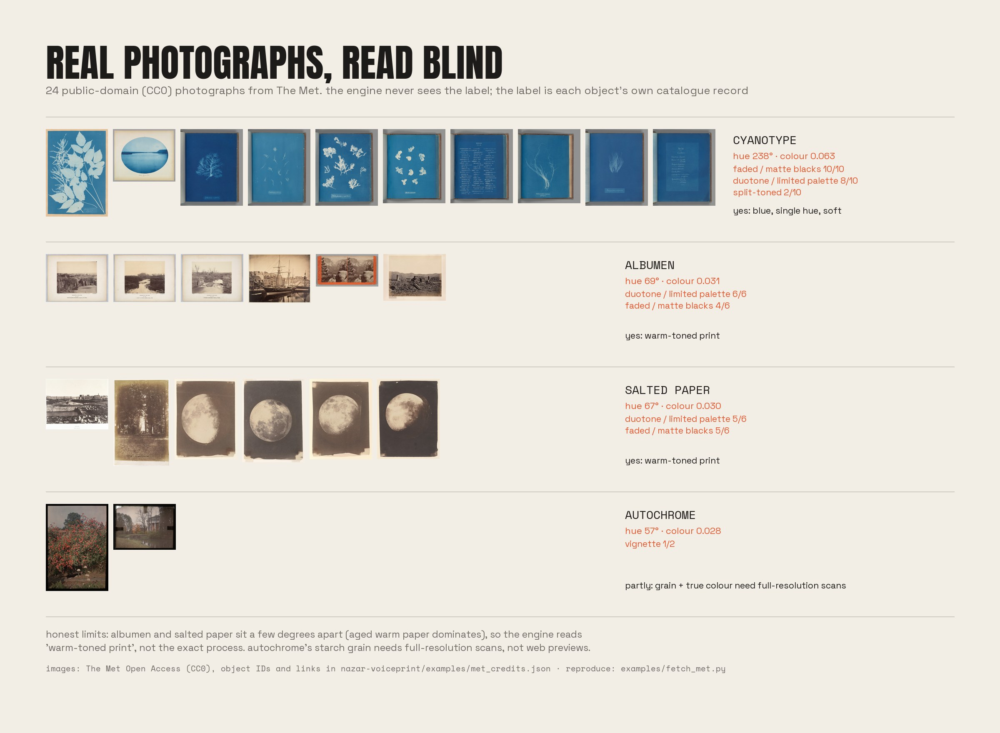
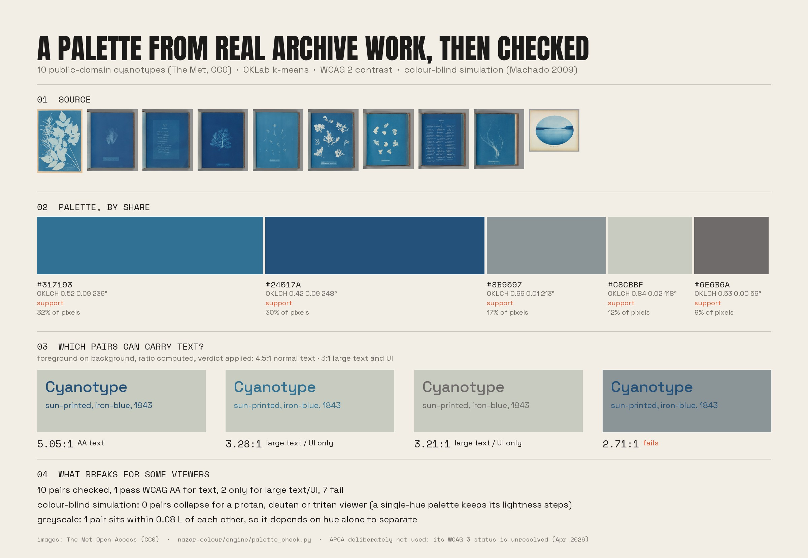
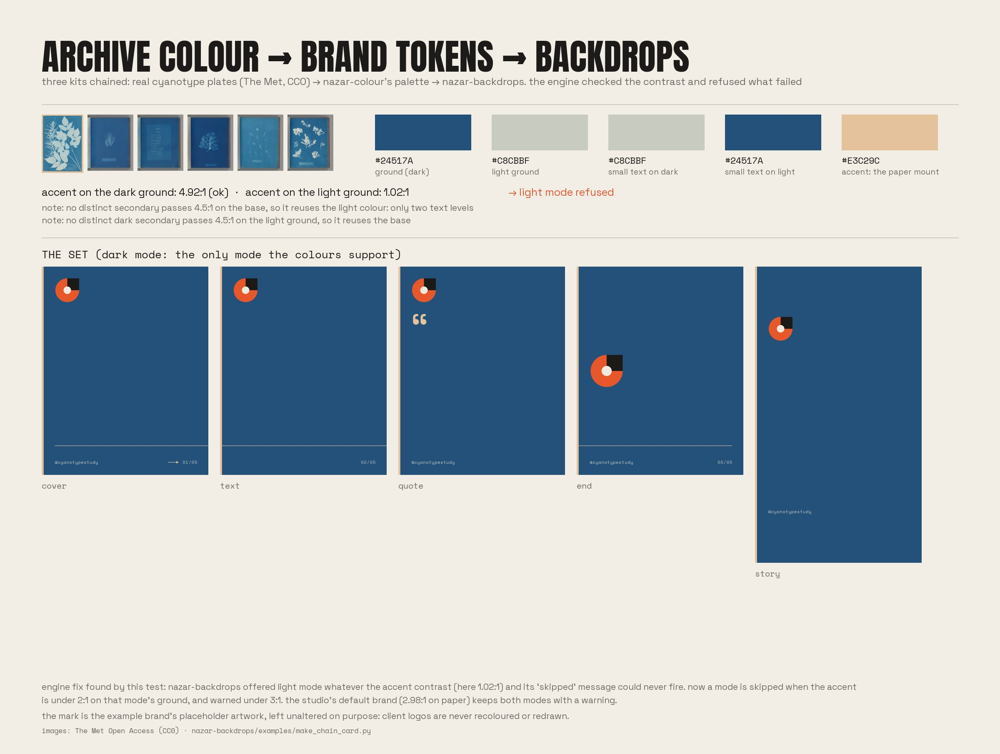
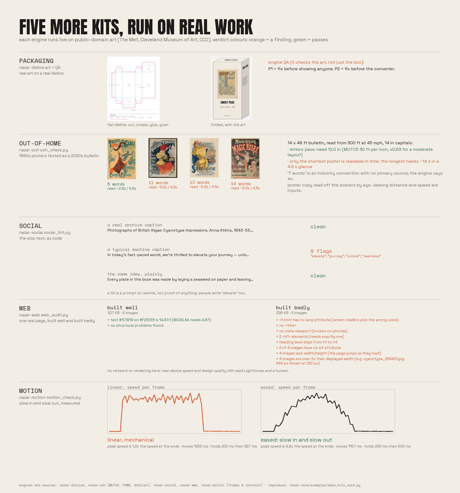

# nazar-studio

> A design studio's brain, hands and toolbox, in folders. The ideas are Nazar's. Claude is the extra pair of hands that never gets tired of redrawing a dieline at 2 a.m.

**nazar-studio** is a set of [Claude Code](https://claude.com/claude-code) skills from Nazar, a creative studio run by Kaif Nathani. It doesn't replace a designer. It works like a very fast, very fussy studio assistant: it asks before it draws, reads old archives instead of scrolling trends, runs real engines (not image generators), and checks its own work before you see it.

**Your prompt leads.** Every kit is an add-on: Claude pulls the pieces your request needs (a rule, a checklist, an engine) and skips the rest.

1. **Asks first.** Every question comes up front, each with options and a recommended pick.
2. **Researches properly.** It reads manuals, archives, standards and primary sources, checks claims against them, and flags openly what it couldn't confirm instead of guessing.
3. **Builds with engines.** Python that draws dielines, traces sketches, lays out packs and outlines type, with outputs you can measure.
4. **Nitpicks before you do.** Automatic QA on every output, and Claude looks at every image itself.
5. **Learns from your work.** Every failure on a real job is logged in the kit's `LESSONS.md` and patched with your okay, so the skill gets better the more it is used.
6. **Stays cheap.** The whole skill costs about 2k tokens to carry; a kit loads only when the job needs it, and engines turn big inputs into small reports ([the numbers](#what-it-costs-in-tokens)).

No AI slop, no stock photos, no "elevate your journey". AI imagery is used only when a client says yes in writing.

## What each kit does

Seventeen kits, one shared brain (`nazar-core`: taste, research method, QA). A job never uses all of them: Claude reads the brief and pulls only what it needs.

- **Think:** `nazar-strategy` finds the positioning, the name and the line with an edge. `nazar-pitch` writes proposals, pricing and contracts and handles feedback.
- **Know whose pattern it is:** `nazar-voiceprint` reads your own old work and writes a file that makes any AI write, script or design like *you*, not like itself. `nazar-colour` builds palettes from real archives and checks contrast and colour-blindness. `nazar-type` chooses and checks fonts, Urdu included. `nazar-art-direction` briefs photography, illustration and icons.
- **Make the marks:** `nazar-logo` takes a mark from 100 thumbnails to every export file. `nazar-illustration` draws in code, like a hand. `nazar-brand-book` turns the identity into a system and a book. `nazar-prompts` writes AI image prompts, only with the client's written yes.
- **Package it:** `nazar-dieline` draws real dielines and puts art on them. `nazar-packaging` makes packs that win the shelf and print cleanly.
- **Put it out:** `nazar-social` for feeds, `nazar-backdrops` for a year of routine posts, `nazar-ooh` for billboards and walls, `nazar-web` for sites, `nazar-motion` for logos that move.

## Quick start

### Install (30 seconds, 0 drama)
```bash
git clone https://github.com/Kaifrizwan12/nazar-studio.git
cp -R nazar-studio/nazar-* ~/.claude/skills/
pip install -r nazar-studio/nazar-core/engine/requirements.txt     # engines: numpy, Pillow, CairoSVG, harfbuzz, fontTools
```
Keep the kits side by side, since they all read `nazar-core`. For a single project, copy them into `.claude/skills/` in that repo instead, and drop `CLAUDE.md` in the root.

### Use
Open your project in Claude and say what you need, or paste a ready-made prompt from [`PROMPTS.md`](PROMPTS.md):
> *"A tuck-end carton for a 60 × 30 × 120 mm tea tin, then three pack routes drafted on it. Sober, one pop colour."*

Then answer the questions. It'll take it from there, and it'll show its homework.

**Extend it for your product:** the engines are plain Python. [`nazar-dieline/EXTENDING.md`](nazar-dieline/EXTENDING.md) tells your Claude how to add a structure, a design block or a QA check, and how to test it.

## Case study: a real archive, run the way a person would

The cards further down test single engines on public-domain files. This is the test that touches the real scenario, so read it first: a designer with a real brand archive, an AI, and directions only the designer can give. [The test case and prompt are in the repo](nazar-voiceprint/examples/case_study.md), so you can run it on your own archive.


**The scenario.** A designer has made about 50 social pieces for one brand (YouthPerks, a student-discount app). The work is AI-assisted, with concept, edits and final hand the designer's, and client-approved. They want four new slides in the same style. They know their own work, so they tell the AI exactly what to do.

**The test.** 28 of the 42 real pieces build the pattern. 14 are held back and never seen by it. Brand files (logo, backdrops) are assets to place, not pieces to learn from. The same four briefs are then made three ways: a casual prompt with no skill, an expert prompt with no skill, and with the skill.

**With the skill** means a fresh agent with the whole skill installed and the task given the way a person would give it: here is my work, make four slides that look like mine, use the exact files, check the headline font, the contrast, the copy and the backdrops with the kits that fit, and check your own slides and QA them before you show me. It decides the rest. It was told not to open the held-out pieces.

**The expert prompt** (shortened; the full one is in [the test case](nazar-voiceprint/examples/case_study.md)):

```text
Format is 4:5. Crop, don't resize, the top 900x1125 of the exact story backdrop files.
Logo on light slides only, multiplied in, never redrawn. Headline: heavy condensed caps,
last line in the brand blue. Under it, one short sentence. Handle bottom-left.
No buttons, pills, icons, mascots, faces or gradients of your own. Must not look AI-made.
Voice: short, English mixed with Roman Urdu. No invented facts. References: <real slides>.
```

**The results.** The score is the share of five checks passed: shape (4:5), ground colour, palette (learned from the exact backdrop files), accent used sparingly, no invented devices. It measures habits, not quality. The headline-blue column is a separate contrast measurement of the colour actually used for headline type on the light slides.

| | Score | Headline blue on light slides | What it means |
|---|---|---|---|
| Real pieces, held out | **0.95** | n/a | The habits found in some pieces describe the rest. |
| New: expert prompt, no skill | **1.00** | 2.5:1 (fails the 3:1 minimum) | Passes every habit check; the contrast fault goes unseen. |
| New: with the skill, fresh agent | **1.00** | 3.2:1 (passes) | Same score; its own check caught the contrast, and it darkened the blue for new type. |
| New: casual prompt, no skill | 0.80 | n/a | Takes the square backdrop as given and misses the 4:5 habit. Checked nothing. |
| New: casual prompt, **with the skill** | **1.00** | 3.2 to 3.8:1 (passes) | Never told the format. The engines measured 4:5 and the light and dark grounds in the archive, and it used them; it moved a failing blue headline to a better spot on the backdrop. |
| New: casual prompt, no skill, told to measure and check | **1.00** | 3.2:1 (passes) | Reaches the same result by writing 10 scripts of its own (about 340 lines). |

**What this shows, plainly.** The skill matters most for a person who doesn't already know their own habits: with a casual prompt it measured the archive and made the 4:5, two-ground slides, where the same casual prompt without it came out square. An agent told to measure and check without the skill gets there too, but it has to write its own tools to do it: [about 10% more tokens and 35% more time](#what-it-costs-in-tokens). Every good run passes every habit check, so the score cannot rank them; by eye they are close. A casual prompt loses one habit (the 4:5 canvas). What the skill added is checking. The expert prompt carries the person's knowledge but cannot see its own mistakes, and the skill run's checks did: the headline blue failed the contrast minimum, the check flagged it, and the agent fixed it. The blue it chose is darker than the brand's, which is the designer's call to confirm.

**What the fresh agent found wrong in the skill.** It reported these without being asked to praise anything, and each is fixed or listed:
- The accent contrast check measured the archive's accent, not the colour on the slide. It now measures the accent type actually used against the ground beside it, and suggests a darker value from that ground.
- Its QA was by eye because no QA tool existed. `qa_views.py` now builds the squint, greyscale and phone-size sheet and measures edges, margins, gaps and small text.
- A missing input file failed silently, and `score_pattern.py` had no help. Both fixed.
- The font matcher was slow (now about 5 seconds) and cannot name a small body sans. Open.
- The score saturates at 1.00. Open: it needs a human pick test.
- A second agent (casual prompt, skill installed) reported more, all fixed: `qa_views.py -h` crashed; the skill had no guidance for turning a square backdrop file into a 4:5 post (it now says crop never scales, and a square-to-4:5 resample must be labelled and the 4:5 source requested); no rule for where accent type sits on a gradient backdrop (the same blue passed at the top and failed beside the glow); and the intake questions clashed with a prompt that already gave the brief (now: ask only what's missing).

**Which kit helped, and how**

| Kit | What it did here |
|---|---|
| nazar-voiceprint | Measured the 28 pieces: 4:5 in 86%, a light and a dark ground, one blue accent; scored the held-out pieces (0.95); flagged devices the archive never uses (a filled button appears in 4% of its pieces); writes the prompt block (`score_pattern.py --prompt`). |
| nazar-colour | Contrast of text and of the accent type on its own ground. Text is fine (17:1 and up). The brand blue on the light ground is about 2.5 to 2.9:1, under the 3:1 large-text minimum. |
| nazar-type | `font_match.py` found Anton the closest of about 800 installed fonts (0.83 to 0.86 overlap) but 7 to 11% wider: a near match, not the brand's font. The slides use it as a labelled stand-in. |
| nazar-backdrops | The rule is "flat, no glows"; this brand's backdrops have grain, glow and a dot grid. The rule now says a brand's exact backdrop files override it, placed as supplied. |
| nazar-social | The copy lint caught "unlock" in a draft. It is English-only, so Roman Urdu lines are written with the person. |
| nazar-core | The studio rules, the exact-assets rule, `chain_check.py` (colour, language, layout, lint, score in one pass), `qa_views.py`, and the loop that logs every failure per kit (`improve.md`, each kit's `LESSONS.md`). |

**What it does not show.** Four briefs and one fresh-agent run are a small sample. No engine reads text inside images, so slide copy was never analysed. The headline font is unconfirmed. The fresh agent redrew the translator-card device from shapes and said so; its icons are not the originals. A person picking real from generated hasn't been run. The held-out set includes pieces with people; none are shown.

**Scenarios.** Seven ways a real person would use the skill, each with the prompt they would write, the kits that run, and whether it has been tested: [scenarios.md](nazar-core/references/scenarios.md).

## What it costs in tokens


A skill is cheap to carry and its engines are cheap to use. This is the design, measured on this repo:

- **Carrying it costs about 2.1k tokens.** Only the 18 short descriptions sit in context. A typical job loads `nazar-core` plus one kit, about 4.7k. The same knowledge pasted into a prompt as text would be about 121k.
- **Engines turn big inputs into small reports.** Looking at the 28 real pieces of the case study costs about 58k tokens; the portfolio engine's whole report is about 0.4k. The engine code (about 88k) is never loaded: only what it prints is.
- **Deterministic work isn't left to the model.** Contrast ratios, margins, stylometry and colour palettes are computed, not guessed, so Claude spends its tokens on judgement.

**Without the skill, Claude builds the tools at runtime.** The test: the same full job from a casual prompt (measure my archive, make four slides, check contrast, the font and the QA). With the skill, a fresh agent ran the built engines: 105k tokens, 32 tool calls, 3.7 minutes. Without it, a fresh agent wrote 10 scripts (about 340 lines) to measure, match fonts, check contrast and QA: 117k tokens, 44 calls, 5.8 minutes. Both passed every check and made good slides, so on this job the skill saves **about 10% of tokens and 35% of time**, and the work is repeatable, because the engines are tested and the runtime scripts aren't.

**The honest part.** That is a modest saving, because this job only needed simple measuring. A bare prompt that checks nothing is cheaper still (57k to 59k) but caught none of the contrast faults. The bigger savings should be in what a runtime agent would find hard to rebuild: stylometry with a Hindustani baseline, dielines, fine-line tracing, font coverage and licences, and the research behind each method. This test didn't need them, so that claim is an expectation, not a measurement. Estimates are characters divided by 4.

## The results, in order of importance

These first cards test the engines on real, public-domain material, not a full run with prompts: the case study above does that. Each card below is a real engine run, with its headline number and what that number means. The independent results come first; the group of five engines comes last.

### 1. Can the engines tell designers apart?


> **The result:** 60% of 35 real prints attributed to the right maker, blind.
>
> **What it means:** Each designer's measurable habits are learned from the *other* prints, then the engine names the maker of the hidden one. The bar to beat is **37%** (always guessing Steinlen, who has 13 of the 35), not 25% (pure chance). It works for consistent makers (Steinlen 10/13, Chéret 6/9) and fails for Lautrec (2/7), whose work spans three modes. These numbers are only the measurable layer: *why* is the maker's to say.

Hide one print, learn each designer from the rest, name the maker: **60% against 37% for always guessing the biggest group and 25% for chance**, on 35 real CC0 prints. Steinlen (10/13) and Chéret (6/9) have a consistent measurable look. Lautrec (2/7) doesn't: his works span flat-colour posters, a pale line print and a dark black-and-white stage poster, so the engine sees three modes, not one hand. That's the right answer, and it's why the VLM pass and the maker's confirmation exist. Credits are in [`cma_credits.json`](nazar-voiceprint/examples/cma_credits.json). Every print was reviewed by eye, and `fetch_cma_designers.py` uses an approved allowlist so nothing unreviewed can slip in.

### 2. Real photographs, read blind



> **The result:** 24 public-domain photographs graded by the engine, which never saw the label (each object's own catalogue record).
>
> **What it means:** All 10 cyanotypes read as one blue hue (about 238°); albumen and salted paper read as warm-toned prints (about 67–69°) but can't be told apart; autochrome is only partly read. It reads the *look*, not the chemistry, and says so.

24 public-domain (CC0) photographs from The Met, grouped by the process **each object's own catalogue record names**, and the engine never sees that label. Cyanotypes come out blue, single-hue and soft; albumen and salted paper come out as warm-toned prints. It can't separate albumen from salted paper, and autochrome grain needs full-resolution scans; the card says so. A blue image on warm paper is never labelled "teal & orange": that name needs a genuinely multi-hue grade. Credits for every image are in [`met_credits.json`](nazar-voiceprint/examples/met_credits.json). Every photo was checked by eye before use, and `fetch_met.py` paces its requests and backs off when rate-limited.

### 3. Type QA on real fonts, including real Urdu


> **The result:** 4 real fonts checked: none of the studio's 3 fonts has the ₨ sign, and Gulzar covers only 4 of 15 Sindhi letters.
>
> **What it means:** Coverage is the share of the characters a job needs that the font actually contains; a missing one prints as an empty box. 1.2 mm is the EU minimum x-height for small print (Art. 13): Gulzar needs **7.7 pt** to reach it, Anton only **4.6 pt**.

`nazar-type/engine/type_check.py` runs the type kit's own checklist on real font files: licence and embedding as the file declares them, coverage per script (Latin, transliteration, pack symbols, Urdu, Sindhi, Devanagari), whether the Arabic-script shaping features exist, kerning, and the **smallest size at which the x-height reaches the 1.2 mm EU rule**. Then a real shaped Urdu line goes through each font, so you can *see* what coverage means. It found real things: none of the studio's own fonts has the **₨ sign**; **Gulzar** sets Urdu beautifully but covers only 4 of 15 Sindhi letters, and needs 7.7 pt for a legal x-height against 4.6 pt for Anton; and Gulzar's file doesn't carry its licence text, so the OFL file from its repository must be filed beside it (confirmed from the source: OFL 1.1). Coverage % says nothing about whether the shapes are good, and the card says so.

### 4. A palette from real archive work, then checked



> **The result:** 10 cyanotypes become a 5-colour palette in which only 1 of 10 colour pairs can carry body text.
>
> **What it means:** WCAG contrast of **4.5:1** is the minimum for body text, 3:1 for large text and UI. Real archive colour is often too narrow to carry type, which is exactly why a palette is checked before it becomes a brand.

`nazar-colour/engine/palette_check.py` does what the colour kit promises: archive images in, palette out (k-means in OKLab), then every pair checked.

- **Contrast:** WCAG 2 ratios, with a verdict per pair. The maths is verified against published values (black on white is 21:1; `#777` on white is 4.48:1, the classic near-miss).
- **Colour-blind:** protan, deutan and tritan simulation (Machado, Oliveira & Fernandes 2009); flags any pair that collapses for a viewer.
- **Greyscale:** pairs that depend on hue alone.
- **Honest on APCA:** deliberately not used, because its place in WCAG 3 is unresolved as of April 2026.

Real archive colour is often *worse* than a designed palette: in this one, only 1 of 10 pairs carries body text. That's the finding, not a flaw, and it's why the kit checks before it ships.

### 5. Archive colour → brand tokens → backdrops



> **The result:** the accent is 4.92:1 on the dark ground and 1.02:1 on the light one, so light mode is refused and 5 dark backdrops are built.
>
> **What it means:** 1.02:1 is invisible. The backdrops engine refuses a mode whose accent can't be seen (under 2:1) and warns under 3:1, so a palette that only supports a dark set gets a dark set and says why.

Three kits chained on real work: ten CC0 cyanotypes → `nazar-colour` → `nazar-backdrops`. Brand roles are assigned **by contrast, not list order** (`derive_tokens`): the small-text colour must reach 4.5:1 on its ground, and the engine says so when a palette is too narrow for it. A mode is skipped when its accent is invisible. This archive supports a dark set only. The mark is the example brand's placeholder, left unaltered on purpose: **client logos are never recoloured or redrawn**.

### 6. Etching → vector


> **The result:** one Rembrandt etching (public domain) becomes 562 shapes and 5,908 nodes with `--fine`.
>
> **What it means:** A node is one anchor on a vector curve: fewer nodes mean a cleaner, more editable shape. Plain mode is for bold marker and pencil; `--fine` is for hairlines and engraving.

`nazar-core/engine/trace.py`: **hands first.** Kaif draws, the machine cleans up.

1. **Clean the photo:** flatten the uneven light, threshold it automatically, despeckle.
2. **Find the corners:** checked at two scales, and pinned so smoothing can't round them off.
3. **Place nodes on the true extremes,** where the curve is really horizontal or vertical, the way a professional vector artist would.
4. **Fit the curves:** Schneider least-squares Béziers, giving a single SVG path with holes kept.

**Hairlines and engraving: `--fine`.** A global threshold loses lines under ~2 px, so plain mode is for bold marker and pencil. `--fine` upscales, uses a *local* threshold (darker than its own neighbourhood) and skips the despeckle opening step, which keeps an etching's tree, figure and hatching (shown above, CC0 from The Met). It stays noisy in the darkest shadow: raise `--min-area` to drop dust. You get three variants (tight, balanced, smooth), a compare sheet and a node report. `--levels 3` traces shaded drawings into recolourable tone layers for package art. It needs only numpy and Pillow, and it's MIT-clean.

### 7. Dielines, and real art on them


> **The result:** the pack engine's own QA flags problems in the art on a real pack (safe area, contrast, a missing logo file) and passes it clean once they're fixed.
>
> **What it means:** It checks the *art* (safe area, contrast, type size, missing logo files), not just the box. A common one: an image block's `y` is its *centre* unless you set `valign: top`, and the engine flags art that crosses the safe area.

`nazar-dieline/engine/dieline.py`: give it the inside dimensions (L × W × D) and the board, and it draws a **concept dieline**.

- **Formats:** layered SVG, PDF, PNG, a **DXF** that opens in CAD (with CUT / CREASE / PERF / GLUE layers), and a spec sheet.
- **14 structures:** ECMA tuck ends, sleeve, glued tray, FEFCO 0201 / 0200 / 0427, pillow, rigid set-up box (blank plus wrap with turn-ins), cone and wrap labels, stand-up pouch, chips flow-wrap, and a shrink-sleeve map.
- **Spec sheet:** flat size, board area, cut and crease rule length (which drives die cost), rough nesting per sheet, and a McKee compression estimate for corrugated.
- **Engineering:** caliper allowances, friction locks, tapered glue flaps, corner reliefs, and grain arrows.
- **Testing:** every DXF passes a CAD audit with zero errors.


Add an `"art"` block and the engine lays out an **MVP pack**, panel by panel.

- **The right way up when folded.** Tucks, lids and bottoms rotate automatically.
- **Real brand assets:** brand tokens, outlined fonts (harfbuzz), the client's exact logo file, bands, patterns that run across folds, and placeholders for copy and the GS1 barcode at true size.
- **Folded oblique preview** of the pack.
- **Transparency handled for real:**
  - A carton window becomes a die-cut hole plus the film patch.
  - Clear and metallised film get "no ink, no white" windows, a **white-ink plate**, and a preview in the product's own colour.
  - Chips packets get the fin seal, serrated crimps and the back art split across the web.
- **Automatic draft QA:** type size in pt, contrast measured against what's actually behind the text, copy overflow, barcode size and fit, net quantity in the bottom 30% of the principal panel, art on the glue flap, windows too close to creases or seals, and light-sensitive snacks behind windows.
- **Send it to Figma:** `--figma` writes a step-by-step build plan for [claude-talk-to-figma-mcp](https://github.com/arinspunk/claude-talk-to-figma-mcp). Upright panels arrive as editable layers and text, and the dieline as a locked layer. The setup guide covers a pinned, localhost-only install for any user's Claude: [`nazar-dieline/FIGMA.md`](nazar-dieline/FIGMA.md).

### 8. Five more engines: packaging QA, billboards, social, web, motion



Five kits, each with its own small engine built on sources and run on real public-domain art. What each result means:

| Kit | The real result | What it means |
|---|---|---|
| **Packaging** | QA flags 3 problems on a real pack; clean once fixed | The engine checks the art, not just the box |
| **Billboards** (`ooh_check.py`) | Of four real 1890s posters, only the 5-word one is readable in time (a 4.5 s glance at 45 mph, 300 ft) | Letter height follows the road-sign rule (30 ft of distance per inch, MUTCD). The "7 words" and "6 seconds" rules are **unsourced folklore** and labelled so |
| **Social** (`social_lint.py`) | A machine-style caption: 9 flags. A real archive caption and a plain rewrite: 0 | The slop test as code. A hit is a prompt to rewrite, never proof of anything |
| **Web** (`web_audit.py`) | The same page built well: 0 problems. Built badly: 8 failed checks | Structure, alt text, layout shift, contrast. No real-device speed: that needs Lighthouse |
| **Motion** (`motion_check.py`) | A linear reveal: peak speed 1.2× its end speed. An eased one: 4.8× | Measures *slow in, slow out* (Thomas & Johnston). It measures, it doesn't prescribe durations |

## How the pattern engine works

### 🫆 Your pattern, not the machine's


**Every AI has a pattern, and everyone can smell it now.** `nazar-voiceprint` pulls *yours* out of the work you made before AI, checks it with you, and hands any AI a file that makes your pattern win over its own.

Drop an archive: a decade of office `.docx` files, a director's scripts, a reel-maker's old scripts, an illustrator's portfolio. You get back **THE PATTERN**, one portable file for Claude, ChatGPT or Gemini.

| Layer | What it reads | Engine |
|---|---|---|
| **Words** | Rhythm (mean *and* spread), punctuation, paragraphing, function-word lean, and the **signature phrases that recur across your documents** (your openers, pivots, sign-offs) | `analyze.py` |
| **Story** | Where your turns land, dialogue cadence, refrains, code-switching, frame breaks, reel pacing from *your own* catalogue | guided read + `analyze.py` |
| **Visual** | Palette habit, air and balance; colour grading and effects; an illustrator's strokes; a designer's grid and type scale; a photographer's camera habits; an editor's cutting rhythm; how people are posed; style modes and reused elements across a portfolio | `portfolio.py` runs them all |

**How it works:**
1. **Pre-AI filter.** `ingest.py` reads every document's real creation date and holds back anything from after 30 Nov 2022, so your pattern doesn't learn a chatbot's. The date is a prompt to ask, not a gate: you decide what goes back in, and if you say the work is yours (AI-assisted but directed by you, as in the case study above), that counts and the pattern is labelled "recent (AI-assisted era)".
2. **Habit vs. genre.** Every feature is tested across the whole archive and marked *habit*, *varies* or *document-driven*. Only habits make it into the pattern. Research on cross-genre idiolect is mixed, so it's tested, never assumed.
3. **Confirm loop.** You get about ten plain statements to say yes or no to, plus *your* never list ("I'd never write *please don't hesitate to reach out*. I'd write *shout if anything looks off*"). Motifs and intent come from you; the research is clear that software can't extract them.
4. **Override-grade output.** The pattern opens with a precedence block, carries real quoted exemplars, pairs every "never" with a "do instead", and makes the AI **draft → check → revise** and re-anchor on your exemplars every few paragraphs, because style drifts back to the model's default the longer it writes.
5. **Test drive.** It writes a sample, measures its *own* output with the same engine, and fixes what fails. In the demo, a Hinglish monologue for an engineering student who secretly loves design went from *"short, flat, even"* (an AI's default cadence) to matching the target rhythm. Then a Hindi-Urdu function-word baseline, built from 1M words of real subtitles, caught a register miss the rhythm couldn't: the draft told a story where the pattern *argues* (*yaar, arey, kyon, na*). Four passes, every one measured. Reading: [`examples/tamasha_pattern.md`](nazar-voiceprint/examples/tamasha_pattern.md).

The demo pattern was read from a famous monologue (*Tamasha*, 2015). Only numbers and short fragments are kept; the script isn't redistributed. A real job profiles **your own** archive. It's honest about the ceiling: 2025–26 research shows prompted style still sits a measurable step away from true authorship, so you get a strong first draft in your voice, not a clone. Built on Mosteller & Wallace, Burrows' Delta, Biber, STRAP, Gatys and Cinemetrics; the citations are in [`nazar-voiceprint/references`](nazar-voiceprint/references).

**The result: an original scene, written to the extracted pattern** (not a scene from any film):

```
[Hostel room. Laptop ki light.]
Compile / Run / Submit.
Ek aur assignment... ek aur green tick... bas? Bas green tick, yaar?
Ammi ne poocha tha, "khush ho?" Khush...? Maine kaha CGPA 8.4 hai. Unhone dobara poocha. Maine phir... CGPA bataya. Kya karta? Aur kya hota hai batane ko?
(camera ki taraf) Arey, aap bhi poochoge? Mat poochna na... jawab wahi hai.
Compile / Run...
Desktop pe ek folder hai. Naam? Misc. Misc mein kya hai? Kuch nahin. Arey, kuch... nahin... bas teen saal ke poster... ek chai waale ka logo jo usne kabhi lagaya hi nahin... fest ka mascot jiski aankhein maine teen raat tak theek ki thi... aur ek font jo sirf apne naam ke liye banaya tha, kyunki koi font mere naam jaisa lagta hi nahin tha...
Kuch nahin.
Second year mein ek ladka tha jo raat bhar ye sab banata tha... subah lecture mein so jaata tha, aur phir bhi pata nahin kaise sabse zyada khush wahi rehta tha... Professor ne kaha, "beta, ye hobby hai." Papa ne kaha, "isse ghar nahin chalta." Seniors ne kaha, "placement mein koi nahin poochta." Ladke ne suna... achcha ladka tha... sunta tha. Usne folder ka naam badal ke misc rakh diya.
Smart move, hai na? Magar misc koi nahin kholta...
Compile / Run / Submit.
Error...
Error? Kyun yaar...? Code to sahi hai... line 42... unexpected indent...
(hasi) Unexpected. Haan. Sab kuch expected tha... bas ye nahin tha.
(mouse misc pe ruk jaata hai)
Double click...? Nahin yaar. Kal viva hai.
...
Single click hi sahi na...?
[Folder khulta hai. Screen rangon se bhar jaati hai.]
Compile... nahin. Aaj nahin.
```

### One engine per creative trade, each tested blind


Every engine was checked against the truth before it was trusted: original work built with a **known** style, then read blind. The orange text on the card is what the engines concluded, untouched. Every engine ships with its known-answer test.

| Trade | Engine | What it reads |
|---|---|---|
| Colourist, photographer | `grade.py` | Look stats, colourfulness, split-toning, faded or crushed blacks, roll-off, vignette, grain, softness, bloom, with labels tagged *measured* or *folklore*. It describes the transform, never a film stock (Yedlin's Display Prep Demo) |
| Illustrator | `strokes.py` | Skeleton → strokes: length, straightness, taper, pressure swing, loose ends (searching vs. confident line). For drawings only: `portfolio.py` leaves it off unless you pass `--line`, because on slides it measures letter edges |
| Graphic designer | `layout.py` | Alignment, columns, margins, type scale matched to named modular scales, type vs. image share. No OCR needed |
| Photographer | `exif_habits.py` | Focal length, aperture, shutter, flash and orientation habits across a shoot |
| Editor, director | `video.py` | Cuts, median and distribution of shot lengths (Salt, Cinemetrics), pace, 1/f rhythm (Cutting 2010), grade across shots |
| Anyone who poses people | `pose.py` | Facing, contrapposto, hands, crop point, headroom, from 2D keypoints (after Impett & Moretti's *Totentanz*) |
| Whole portfolio | `cluster.py` | Style modes (most creatives have 2–3) and elements reused across pieces |
| Designer, illustrator | the **VLM pass** (`views.py` + a researched protocol) | Everything numbers can't find: a hidden second image in the negative space, hands drawn as mittens, a recurring joke, how type sits in the image |

Rerun every test yourself: [`examples/make_genre_demos.py`](nazar-voiceprint/examples/make_genre_demos.py).

### For designers and illustrators: numbers find the measurable part, then Claude *looks*
Graphic design and illustration are full of patterns no engine measures. So the kit directs a vision model with a researched protocol instead of letting it free-associate:
- **`views.py`** builds the views a VLM needs: a squint test, greyscale, a 4-colour flat, an edge map, five full-detail crops, and a contact sheet of the whole body of work. Vision models are weak at fine detail and counting (*Vision language models are blind*, 2024), so they get crops and the engines do the counting.
- **Open discovery first** (list everything that recurs, no taxonomy), then **lenses with sources**: Morelli's habitual minor details (the method behind Ginzburg's *Clues*), Wölfflin's five pairs, Kress & van Leeuwen's grammar of visual design, McCloud's closure and abstraction, Gestalt figure-ground, plus studio lenses for subject, the wink, type-and-image, edges, texture, rhythm and frames.
- **Evidence or it doesn't count:** every claim names a piece and a crop, a habit needs **≥3 pieces**, nothing is attributed to another artist, and *why* is asked of the maker, never guessed.
- **A real run on ten public-domain cyanotypes:** [`examples/vlm_pass_cyanotypes.md`](nazar-voiceprint/examples/vlm_pass_cyanotypes.md). It finds the isolation, the caption convention and the hand-spaced arrangements, and refuses to claim three things a loose description would have: the process look, the museum's photography, and a "style" that was actually two makers.

## 🖋️ Drawing in code


`nazar-illustration/engine/ink.py`: illustration that behaves like a pen, not a filter.

- **Pressure strokes:** filled outlines that taper at the ends.
- **Smooth paths, real corners:** centripetal Catmull–Rom splines through hand-placed points, with only slow, low-frequency wobble.
- **Tone from marks:** nested hatching (four tones) and Poisson-disk stipple.
- **Print look:** flats misregistered like real printing, plus ink density and paper grain.
- **Concept first:** every illustration starts with a one-sentence idea, a focal point, a light direction and a budget.
- **Honest about limits:** for complex scenes, Claude also hands you a ready image prompt (used only with client approval).

## How it stays honest

Every number on these cards comes out of an engine run on real work. Where an engine can't do something, it's written down here, not hidden.

| Proven on real work | Weak, and documented | Not tested yet |
|---|---|---|
| Colour palettes and contrast (24 photos, 10 cyanotypes) · type QA on 4 real fonts · designer attribution (35 prints, 60% against a 37% baseline) · backdrops from archive colour · fine-line tracing · the pack engine's own QA | `strokes.py` can't read taper or pressure from a carved or etched line (loose ends and straightness do separate media), and it warns when a scan is too small, under ~4 px of line · plain `trace.py` is for bold marker (use `--fine`) · "7 words" and "6 seconds" for billboards are unsourced folklore, and labelled that way · coverage % says nothing about whether a typeface is *good* | Voiceprint on a full real archive · pose and camera-habit tools on real photos · video tools on real footage · anything on real Pakistani packs, shop boards or Urdu print |

**Added by the case study.** Proven: the habits measured on 28 real pieces hold on the 14 held back (0.95); the accent-contrast and QA tools catch real faults and are quiet on clean slides. Weak: the habit score saturates at 1.00 so it can't rank good work, no engine reads text inside images, and the font matcher can't name a small body sans. Not tested yet: a human picking real from generated, the pose, EXIF and video tools on real files, and a full personal writing archive.

Rules that never bend: **a client's logo is never recoloured or redrawn**, every image is looked at by eye before it ships, and AI imagery needs the client's written yes.

## At a glance

Every card in one grid.

<table>
<tr>
<td width="33%"><a href="#the-results-in-order-of-importance"></a><br><sub><b>Dielines</b> from three numbers</sub></td>
<td width="33%"><a href="#the-results-in-order-of-importance"></a><br><sub><b>Real art</b> on a real dieline, with QA</sub></td>
<td width="33%"><a href="#the-results-in-order-of-importance"></a><br><sub><b>Etching → vector</b>, fine-line mode</sub></td>
</tr>
<tr>
<td width="33%"><a href="#the-results-in-order-of-importance"></a><br><sub><b>Your pattern</b>, not the machine's</sub></td>
<td width="33%"><a href="#the-results-in-order-of-importance"></a><br><sub><b>Tell designers apart?</b> 35 real prints, blind</sub></td>
<td width="33%"><a href="#the-results-in-order-of-importance"></a><br><sub><b>Real photographs</b>, 24 CC0, read blind</sub></td>
</tr>
<tr>
<td width="33%"><a href="#the-results-in-order-of-importance"></a><br><sub><b>Palettes</b> from real archives, checked</sub></td>
<td width="33%"><a href="#the-results-in-order-of-importance"></a><br><sub><b>Type QA</b> on real fonts, incl. real Urdu</sub></td>
<td width="33%"><a href="#the-results-in-order-of-importance"></a><br><sub><b>Archive → tokens → backdrops</b></sub></td>
</tr>
</table>

## About Kaif
**Muhammad Kaif Nathani** is a brand and art director. He makes identities and brand books for food, FMCG, tech, studios and services, and this repo is how he works, written down so Claude can work that way too.

He runs **Nazar**, a Karachi studio that plans the street and the feed as one campaign.

- **Archive before algorithm.** Every choice comes from something real: a 1970s manual, a hand-painted shop board, a bus route map, a crate label. If he can't show the client where an idea came from, it doesn't make the cut. He goes looking for inspiration; he doesn't wait for the feed to serve it.
- **Sober, then a wink.** His pages are calm, use one accent and leave a lot of air. Somewhere on page 47 there's a detail that only makes sense the second time you look.
- **Desi at heart, cinematic at eye level.** He loves hand-painted signs, wedding-card type, film title cards and end credits, all set on a strict grid. Loud colour goes on quiet pages, never everywhere.
- **Allergic to "elevate your journey".** If you could swap the logo and the line still works, the line is dead. He writes twenty, says them out loud on the street, and keeps the three that make someone smirk.
- **Hands first.** AI can help the hands, but it never replaces the brain.

**How Kaif works with the skill** (observed while building and testing it):

- **Real work over demos.** Kaif asks for the test case and the prompt to be shown, and wants the control to be a good human prompter, not a strawman. A result that doesn't hold up gets written down as it is.
- **Exact files over recreations.** Backdrops and logos are placed as supplied. A recreated gradient or a redrawn logo is the quickest way a piece starts to look AI-made.
- **The maker's word counts.** Work that is AI-assisted but directed, edited and finished by the designer, and approved by the client, is the designer's own. The pattern says so instead of hiding it. The case study's archive is Kaif's social work for YouthPerks, a Pakistani student-discount app.
- **Short and bilingual.** The voice is direct and mixes English with Roman Urdu: "Verify karo", "Pehle aap, phir baaki sab". Copy that could belong to any brand is cut.
- **Plain, in order of importance.** Cards are simple, numbers come with what they mean, and the README says what didn't work.
- **Engines over improvisation.** A skill should arrive with its tools built, so Claude runs them instead of inventing them mid-job. Every failure goes into the kit's `LESSONS.md`.

His preferences live in [`nazar-core/references/kaif.md`](nazar-core/references/kaif.md). Fork the repo, swap in your own taste, and the whole studio follows. (Keep the wink, though. He'd want that.)

### The founder's note


## Credits
Method and taste by **Kaif Nathani** / Nazar. Standing on the shoulders of Vignelli, Rand, Rams, Müller-Brockmann, Aicher, Crouwel, Games, Gill, Bass, Albers and a lot of very patient archivists. Fonts in `nazar-core/engine/fonts` are SIL OFL (licences included).

Made with two eyes open. 👁️👁️
