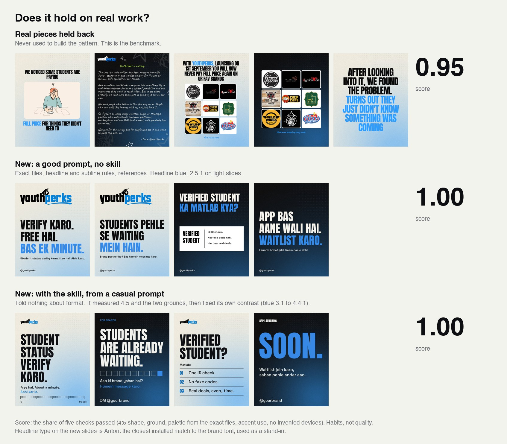
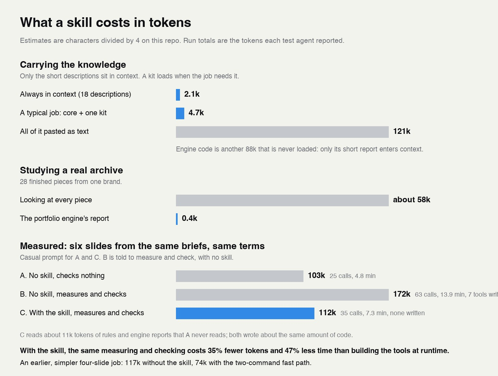

# The case study in full

Back to the [README](../README.md).

## The idea, and a real test of it

**A designer already has a mind.** They know their brand, they know what to follow and what never to do, and they tell the AI. The skill doesn't replace that. It gives the AI what it would otherwise have to guess or build in the middle of the job: engines that **measure the person's own work**, checks that **catch what a prompt can't see**, and a loop that **learns from every failure**. The result is the same quality of work, fewer tokens, and nothing guessed.

**The test.** One real brand archive (42 social pieces for the brand, a student-discount app; AI-assisted, directed and finished by the designer, approved by the client). 28 pieces teach, 14 are held back and never seen. Three fresh agents then make the same six briefs on the same terms: the same exact backdrop, logo and mascot files, no faces or stock, the brand's own devices welcome, its real handle, copy in its voice. Two blind judges, who know only the brand's reference pieces, score a shuffled mix of the held-back real slides and all 18 new ones, for brand fit and quality (1 to 5). [The test case is in the repo](../nazar-voiceprint/examples/case_study.md), so you can run it on your own archive.

- **A. Casual prompt, no skill.** What an ordinary designer would type. It looked at the archive by eye and checked nothing.
- **B. No skill, told to measure and check.** The same, plus "measure my work and check contrast, font and QA". With no skill, it had to write its own tools.
- **C. Casual prompt, with the skill.** The same casual prompt as A, with the skill installed and "check and QA your own work".

| | A. Casual, no skill | B. Measure and check, no skill | **C. Casual, with the skill** |
|---|---|---|---|
| Brand fit (blind judges; real pieces score 3.70) | 2.83 | **3.08** | 3.00 |
| Quality (real pieces score 2.70) | 3.33 | **3.50** | 3.42 |
| Passed the habit checks (4:5, grounds, palette...) | 0.80, came out square | 1.00 | **1.00** |
| Weakest headline-blue contrast (3:1 is the minimum) | 2.7:1 | 2.9:1 | 2.8:1 |
| Tools it wrote itself | none | 7 | **none** |
| Words the person wrote | 366 | 474 | **425** |
| Tokens | 103k | 172k | **112k** |
| Tool calls | 25 | 63 | **35** |
| Time | 4.8 min | 13.9 min | **7.3 min** |

**What it shows, plainly.**
- **On how the slides look, the skill is not better.** It matches the careful no-skill run (fit 3.00 against 3.08, which is within the noise of six slides and two judges) and sits a little above the casual run (2.83). All three are well below the real pieces (3.70), and the judges named every generated slide as generated (98% accuracy): too tidy and formulaic, the same polished mascot and props, where real work is blunter, messier and more varied.
- **On what it takes to get there, it is clearly better.** The skill reaches the careful run's result with **35% fewer tokens, 44% fewer tool calls, 47% less time and 49 fewer words from the person**, because it runs engines that are already built and tested instead of writing its own. Against the casual run, which checks nothing, it costs about 9% more tokens, and that extra is rules and engine reports (about 11k tokens read), not code: both wrote about the same amount.
- **The 4:5 habit** is the one thing a casual prompt without the skill missed: it came out square. The pieces held back score 0.95 on the same habit checks, so the habits found in some work describe the rest.
- **Contrast** is a tie at the line: all three runs set some headline blue just under 3:1. The skill's check reports it; the no-skill runs' own checks reported zero failures.

**Where the skill fell short, and what changed.** The skill run was plainer than B: B used the brand's recurring devices (a lanyard ID card, an alert window, stars, a ticket) throughout, and the skill's `learn` had measured numbers without looking at the archive. Each run's report fed back into the kit's `LESSONS.md` and the skill (`nazar-core/references/improve.md`):
- `learn` now writes contact sheets and a `devices.md` to fill in after looking, reads the archive's own voice and handle by OCR, and `check` warns if the devices list is empty.
- Contrast is checked on the colour actually used, by height, ignoring a mascot's blue.
- `place_asset.py` places a mascot without multiply (which turned yellow shoes olive) and a square backdrop for a 4:5 post as a labelled resample.
- `qa_views.py` writes 100% detail crops (a strike-through that slanted off its text only showed there) and flags overlapping lines.
- Slide text is read by OCR (98% of the words in a known-answer test), and `learn` runs in about 80 seconds, with progress.

**Which kit did what**

| Kit | In this test |
|---|---|
| nazar-voiceprint | Measured the 28 pieces (4:5 in 86%, a light and a dark ground, one blue accent, no filled buttons), scored the 14 held back, and writes the prompt block (`score_pattern.py --prompt`). |
| nazar-colour | Contrast of text, and of accent type on its own ground. Text is fine (17:1 and up); the brand blue on the light ground is 2.5 to 2.9:1, under the 3:1 large-text minimum. |
| nazar-type | `font_match.py` finds the closest installed font: Anton for the headline (0.83 to 0.86 overlap, 7 to 11% wider), reported as a near match. For small body text it gives a shortlist of three, not a name. |
| nazar-backdrops | A brand's own backdrop files override the "flat, no glows" rule and are placed as supplied. |
| nazar-social | The copy lint caught "unlock" in a draft. It is English-only, so Roman Urdu lines are written with the person, and the check says how much it skipped. |
| nazar-core | The studio rules, `studio.py`, `chain_check.py`, `qa_views.py`, `read_text.py`, `place_asset.py`, and the improve loop. |

**What it does not show yet.** Six slides a run, one run a condition and two model judges: a small sample, and the judges are models, not people. A real person choosing real from generated hasn't been run (`nazar-voiceprint/engine/pick_test.py` builds that test). The habit score passes every good slide, so it cannot rank good work. The headline font is unconfirmed, and small body text gets a shortlist of three, not a name. Seven ways a real person would use the skill, with their prompts and what has and hasn't been tested, are in [scenarios.md](../nazar-core/references/scenarios.md).

**Second round: the improved skill.** After the lessons above were fixed (a device vocabulary finder and a drawing kit were built by an agent the owner directed; `learn` now forces a look at the archive's devices), the skill condition was rerun on identical terms and judged blind again (one judge, 24 shuffled slides, the earlier skill run and the no-skill measure-and-check run as anchors).

| One judge, six slides each | Brand fit | Quality | Tokens | Tool calls | Time |
|---|---|---|---|---|---|
| Real pieces, held back | 3.50 | 2.33 | | | |
| B. No skill, measure and check | 3.33 | 3.67 | 172k | 63 | 13.9 min |
| Skill, first version | 3.17 | 3.83 | 112k | 35 | 7.3 min |
| **Skill, improved** | **3.17** | **3.50** | **99k** | **23** | **6.1 min** |

On look, the improvement did not move the needle: fit is unchanged at 3.17 and the gap to the no-skill run (0.16) is within the noise of six slides and one judge. The judge named every generated slide as generated again ("too tidy and concept-driven, a pasted-in mascot or a rebuilt device in a template-like layout"). The improvement is in cost: 42% fewer tokens, 63% fewer calls and 56% less time than the no-skill run that does the same measuring and checking.

## What it costs in tokens

A skill is cheap to carry and its engines are cheap to use. This is the design, measured on this repo:

- **Carrying it costs about 2.1k tokens.** Only the 18 short descriptions sit in context. A typical job loads `nazar-core` plus one kit, about 4.7k. The same knowledge pasted into a prompt as text would be about 121k.
- **Engines turn big inputs into small reports.** Looking at the 28 real pieces of the case study costs about 58k tokens; the portfolio engine's whole report is about 0.4k. The engine code (about 88k) is never loaded: only what it prints is.
- **Deterministic work isn't left to the model.** Contrast ratios, margins, stylometry and colour palettes are computed, not guessed, so Claude spends its tokens on judgement.

**Without the skill, Claude builds the tools at runtime.** In the fair test above, the no-skill run told to measure and check wrote seven tools of its own (a measurer, a font matcher, a drawing library, a contrast checker, a habits comparison, a QA sheet maker): 172k tokens, 63 tool calls, 14 minutes. With the skill, the same measuring and checking took **112k tokens, 35 calls and 7 minutes**: 35% fewer tokens, 44% fewer calls and 47% less time.

**Where the tokens go.** Against a casual run that checks nothing (103k), the skill costs about 9% more, and the extra is rules and engine reports read back (about 11k tokens), not code: both wrote about the same amount, mostly the slide-building script. The skill's extra spend is the rules and the QA, which is what the no-skill casual run lacks. On an earlier, simpler four-slide job, a two-command fast path (`studio.py learn` and `check`) cut the skill run from 105k to 74k tokens and 32 to 19 calls, against 117k and 44 calls for a no-skill run that built its own tools: most of a run is the conversation re-read on every call, so fewer calls is where the saving comes from.

**The honest part.** These jobs only needed simple measuring. The bigger savings should be in what a runtime agent would find hard to rebuild: stylometry with a Hindustani baseline, dielines, fine-line tracing, font coverage and licences, and the research behind each method. This test didn't need them, so that claim is an expectation, not a measurement. Estimates are characters divided by 4; run totals are what each agent reported.

