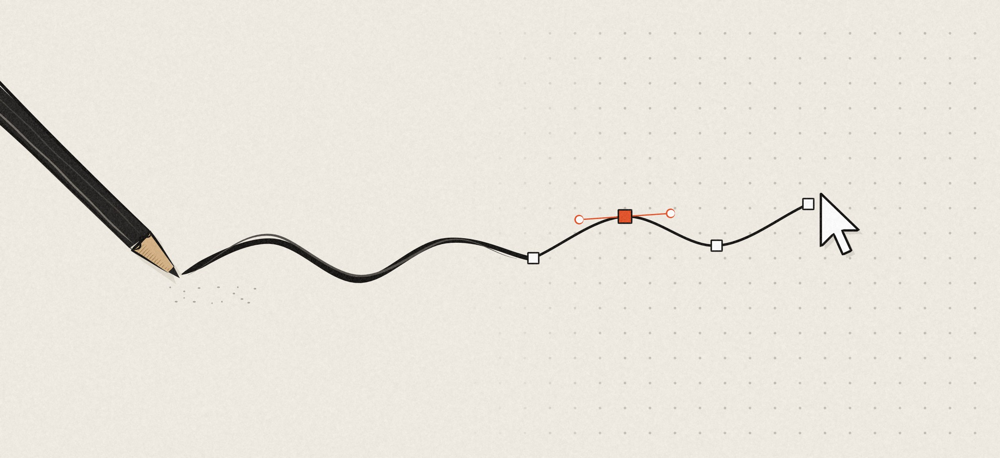

# How the engines work

Back to the [README](../README.md).

## How the pattern engine works

### 🫆 Your pattern, not the machine's


**Every AI has a pattern, and everyone can smell it now.** `nazar-voiceprint` pulls *yours* out of the work you made before AI, checks it with you, and hands any AI a file that makes your pattern win over its own.

Drop an archive: a decade of office `.docx` files, a director's scripts, a reel-maker's old scripts, an illustrator's portfolio. You get back **THE PATTERN**, one portable file for Claude, ChatGPT or Gemini.

| Layer | What it reads | Engine |
|---|---|---|
| **Words** | Rhythm (mean *and* spread), punctuation, paragraphing, function-word lean, and the **signature phrases that recur across your documents** (your openers, pivots, sign-offs) | `analyze.py` |
| **Story** | Where your turns land, dialogue cadence, refrains, code-switching, frame breaks, reel pacing from *your own* catalogue | guided read + `analyze.py` |
| **Visual** | Palette habit, air and balance; colour grading and effects; an illustrator's strokes; a designer's grid and type scale; a photographer's camera habits; an editor's cutting rhythm; how people are posed; style modes and reused elements across a portfolio | `portfolio.py` runs them all |

**How it works:**
1. **Pre-AI filter.** `ingest.py` reads every document's real creation date and holds back anything from after 30 Nov 2022, so your pattern doesn't learn a chatbot's. The date is a prompt to ask, not a gate: you decide what goes back in, and if you say the work is yours (AI-assisted but directed by you, as in the case study above), that counts and the pattern is labelled "recent (AI-assisted era)".
2. **Habit vs. genre.** Every feature is tested across the whole archive and marked *habit*, *varies* or *document-driven*. Only habits make it into the pattern. Research on cross-genre idiolect is mixed, so it's tested, never assumed.
3. **Confirm loop.** You get about ten plain statements to say yes or no to, plus *your* never list ("I'd never write *please don't hesitate to reach out*. I'd write *shout if anything looks off*"). Motifs and intent come from you; the research is clear that software can't extract them.
4. **Override-grade output.** The pattern opens with a precedence block, carries real quoted exemplars, pairs every "never" with a "do instead", and makes the AI **draft → check → revise** and re-anchor on your exemplars every few paragraphs, because style drifts back to the model's default the longer it writes.
5. **Test drive.** It writes a sample, measures its *own* output with the same engine, and fixes what fails. In the demo, a Hinglish monologue for an engineering student who secretly loves design went from *"short, flat, even"* (an AI's default cadence) to matching the target rhythm. Then a Hindi-Urdu function-word baseline, built from 1M words of real subtitles, caught a register miss the rhythm couldn't: the draft told a story where the pattern *argues* (*yaar, arey, kyon, na*). Four passes, every one measured. Reading: [`examples/tamasha_pattern.md`](../nazar-voiceprint/examples/tamasha_pattern.md).

The demo pattern was read from a famous monologue (*Tamasha*, 2015). Only numbers and short fragments are kept; the script isn't redistributed. A real job profiles **your own** archive. It's honest about the ceiling: 2025–26 research shows prompted style still sits a measurable step away from true authorship, so you get a strong first draft in your voice, not a clone. Built on Mosteller & Wallace, Burrows' Delta, Biber, STRAP, Gatys and Cinemetrics; the citations are in [`nazar-voiceprint/references`](../nazar-voiceprint/references).

**The result: an original scene, written to the extracted pattern** (not a scene from any film):

```
[Hostel room. Laptop ki light.]
Compile / Run / Submit.
Ek aur assignment... ek aur green tick... bas? Bas green tick, yaar?
Ammi ne poocha tha, "khush ho?" Khush...? Maine kaha CGPA 8.4 hai. Unhone dobara poocha. Maine phir... CGPA bataya. Kya karta? Aur kya hota hai batane ko?
(camera ki taraf) Arey, aap bhi poochoge? Mat poochna na... jawab wahi hai.
Compile / Run...
Desktop pe ek folder hai. Naam? Misc. Misc mein kya hai? Kuch nahin. Arey, kuch... nahin... bas teen saal ke poster... ek chai waale ka logo jo usne kabhi lagaya hi nahin... fest ka mascot jiski aankhein maine teen raat tak theek ki thi... aur ek font jo sirf apne naam ke liye banaya tha, kyunki koi font mere naam jaisa lagta hi nahin tha...
Kuch nahin.
Second year mein ek ladka tha jo raat bhar ye sab banata tha... subah lecture mein so jaata tha, aur phir bhi pata nahin kaise sabse zyada khush wahi rehta tha... Professor ne kaha, "beta, ye hobby hai." Papa ne kaha, "isse ghar nahin chalta." Seniors ne kaha, "placement mein koi nahin poochta." Ladke ne suna... achcha ladka tha... sunta tha. Usne folder ka naam badal ke misc rakh diya.
Smart move, hai na? Magar misc koi nahin kholta...
Compile / Run / Submit.
Error...
Error? Kyun yaar...? Code to sahi hai... line 42... unexpected indent...
(hasi) Unexpected. Haan. Sab kuch expected tha... bas ye nahin tha.
(mouse misc pe ruk jaata hai)
Double click...? Nahin yaar. Kal viva hai.
...
Single click hi sahi na...?
[Folder khulta hai. Screen rangon se bhar jaati hai.]
Compile... nahin. Aaj nahin.
```

### One engine per creative trade, each tested blind


Every engine was checked against the truth before it was trusted: original work built with a **known** style, then read blind. The orange text on the card is what the engines concluded, untouched. Every engine ships with its known-answer test.

| Trade | Engine | What it reads |
|---|---|---|
| Colourist, photographer | `grade.py` | Look stats, colourfulness, split-toning, faded or crushed blacks, roll-off, vignette, grain, softness, bloom, with labels tagged *measured* or *folklore*. It describes the transform, never a film stock (Yedlin's Display Prep Demo) |
| Illustrator | `strokes.py` | Skeleton → strokes: length, straightness, taper, pressure swing, loose ends (searching vs. confident line). For drawings only: `portfolio.py` leaves it off unless you pass `--line`, because on slides it measures letter edges |
| Graphic designer | `layout.py` | Alignment, columns, margins, type scale matched to named modular scales, type vs. image share. No OCR needed |
| Photographer | `exif_habits.py` | Focal length, aperture, shutter, flash and orientation habits across a shoot |
| Editor, director | `video.py` | Cuts, median and distribution of shot lengths (Salt, Cinemetrics), pace, 1/f rhythm (Cutting 2010), grade across shots |
| Anyone who poses people | `pose.py` | Facing, contrapposto, hands, crop point, headroom, from 2D keypoints (after Impett & Moretti's *Totentanz*) |
| Whole portfolio | `cluster.py` | Style modes (most creatives have 2–3) and elements reused across pieces |
| Designer, illustrator | the **VLM pass** (`views.py` + a researched protocol) | Everything numbers can't find: a hidden second image in the negative space, hands drawn as mittens, a recurring joke, how type sits in the image |

Rerun every test yourself: [`examples/make_genre_demos.py`](../nazar-voiceprint/examples/make_genre_demos.py).

### For designers and illustrators: numbers find the measurable part, then Claude *looks*
Graphic design and illustration are full of patterns no engine measures. So the kit directs a vision model with a researched protocol instead of letting it free-associate:
- **`views.py`** builds the views a VLM needs: a squint test, greyscale, a 4-colour flat, an edge map, five full-detail crops, and a contact sheet of the whole body of work. Vision models are weak at fine detail and counting (*Vision language models are blind*, 2024), so they get crops and the engines do the counting.
- **Open discovery first** (list everything that recurs, no taxonomy), then **lenses with sources**: Morelli's habitual minor details (the method behind Ginzburg's *Clues*), Wölfflin's five pairs, Kress & van Leeuwen's grammar of visual design, McCloud's closure and abstraction, Gestalt figure-ground, plus studio lenses for subject, the wink, type-and-image, edges, texture, rhythm and frames.
- **Evidence or it doesn't count:** every claim names a piece and a crop, a habit needs **≥3 pieces**, nothing is attributed to another artist, and *why* is asked of the maker, never guessed.
- **A real run on ten public-domain cyanotypes:** [`examples/vlm_pass_cyanotypes.md`](../nazar-voiceprint/examples/vlm_pass_cyanotypes.md). It finds the isolation, the caption convention and the hand-spaced arrangements, and refuses to claim three things a loose description would have: the process look, the museum's photography, and a "style" that was actually two makers.

## 🖋️ Drawing in code


`nazar-illustration/engine/ink.py`: illustration that behaves like a pen, not a filter.

- **Pressure strokes:** filled outlines that taper at the ends.
- **Smooth paths, real corners:** centripetal Catmull–Rom splines through hand-placed points, with only slow, low-frequency wobble.
- **Tone from marks:** nested hatching (four tones) and Poisson-disk stipple.
- **Print look:** flats misregistered like real printing, plus ink density and paper grain.
- **Concept first:** every illustration starts with a one-sentence idea, a focal point, a light direction and a budget.
- **Honest about limits:** for complex scenes, Claude also hands you a ready image prompt (used only with client approval).

