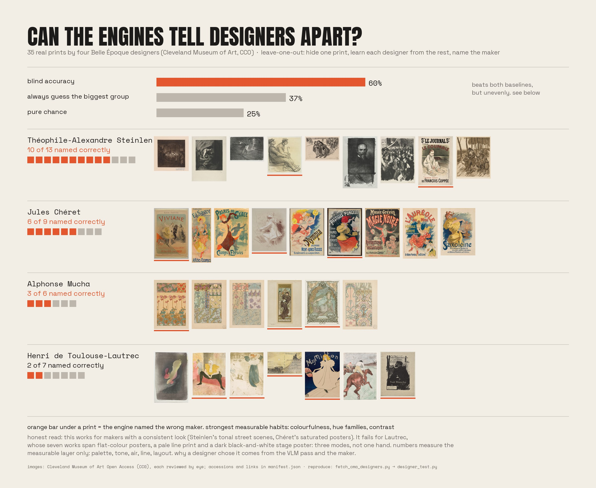
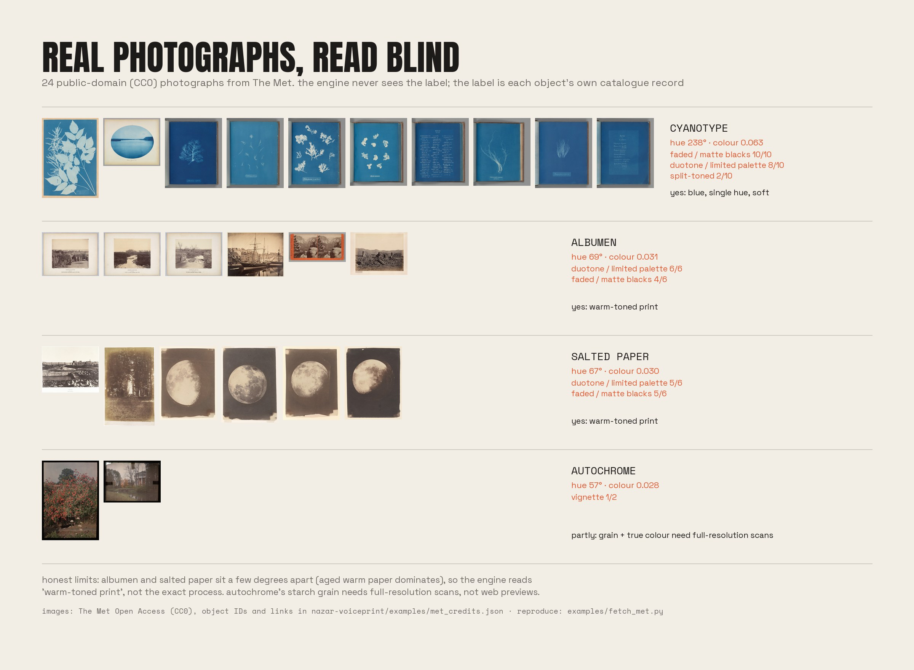
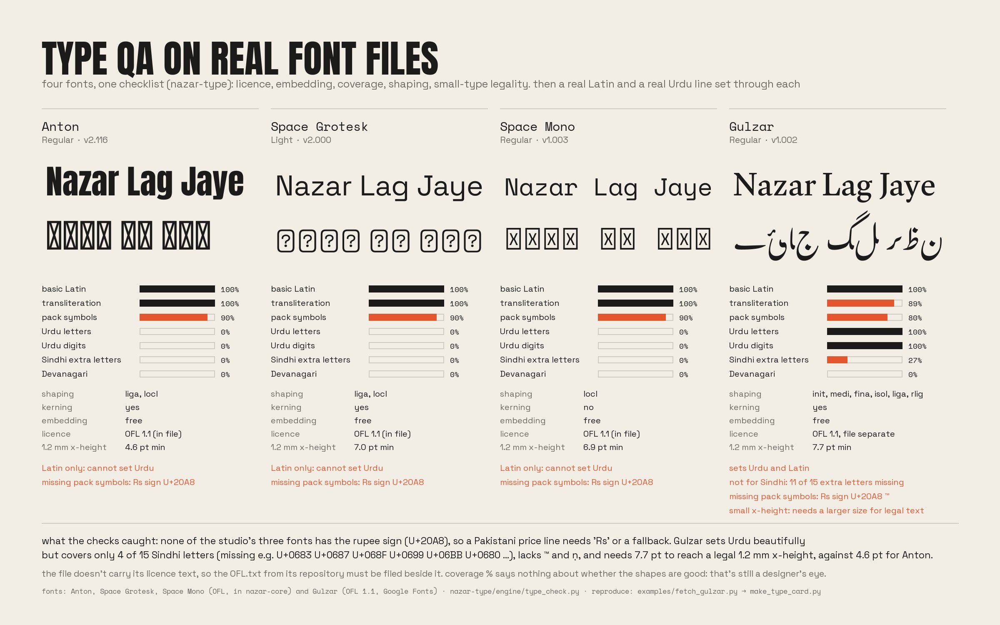
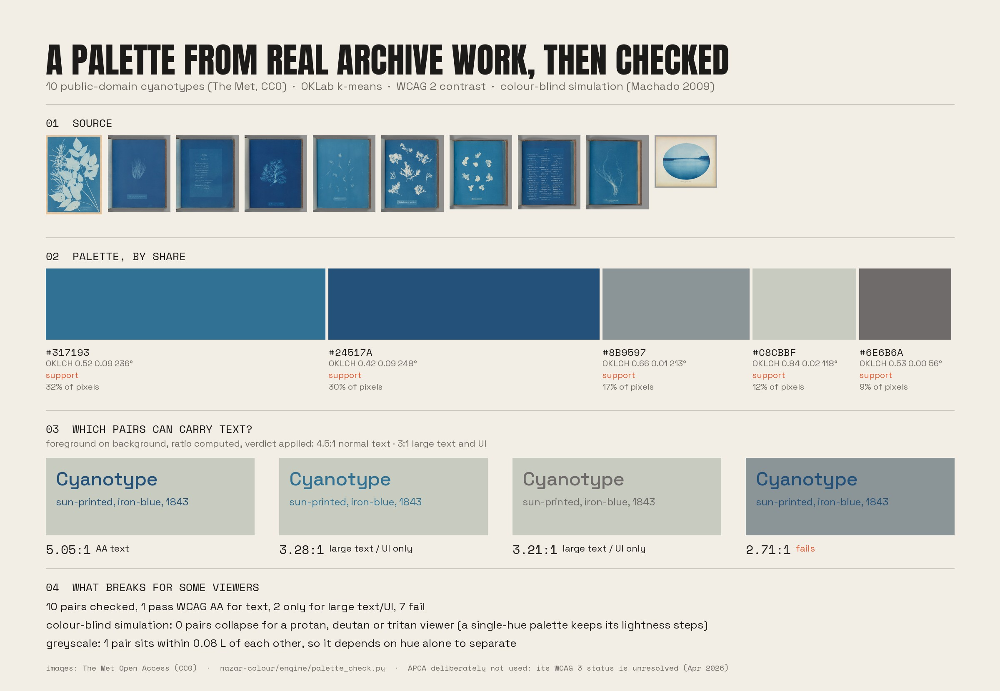
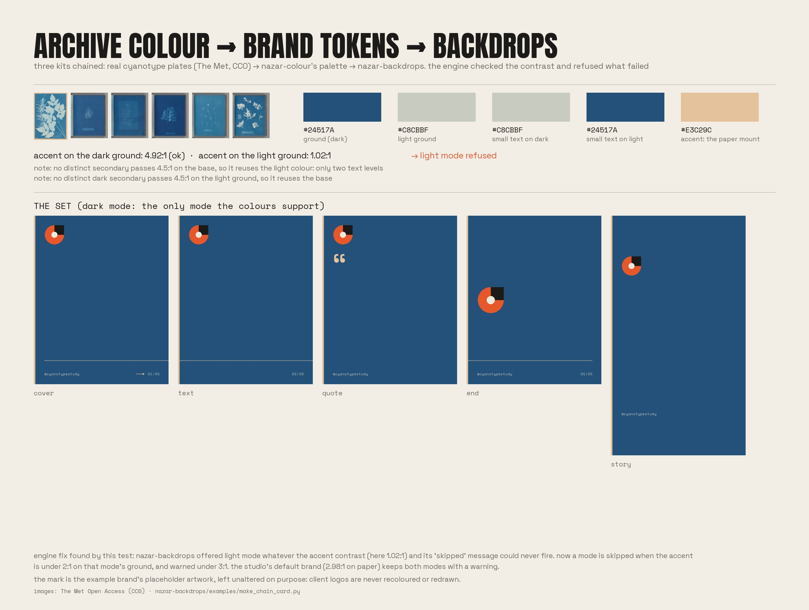
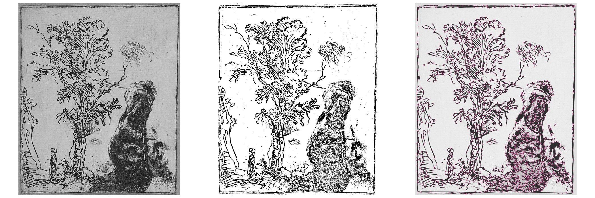
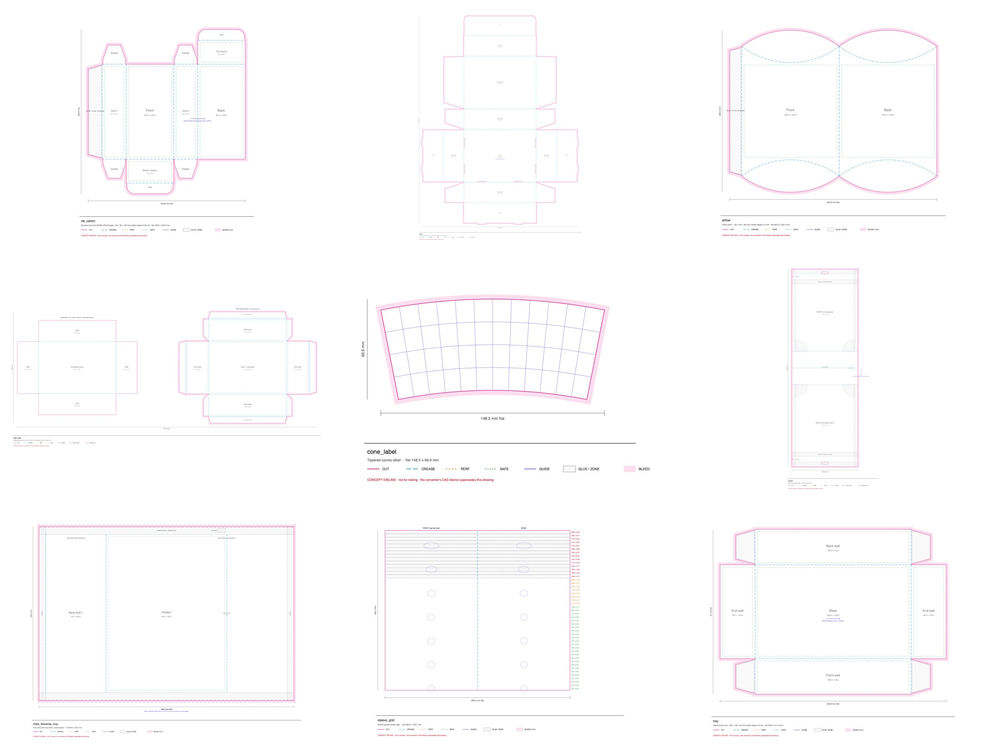
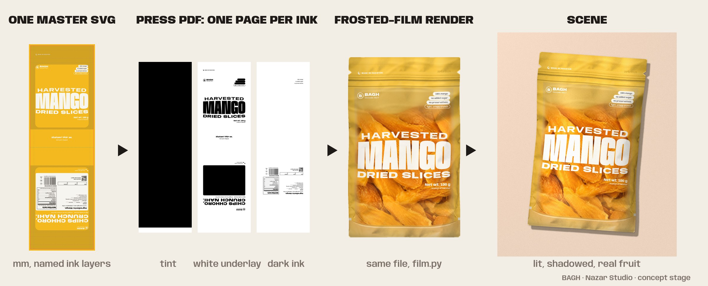
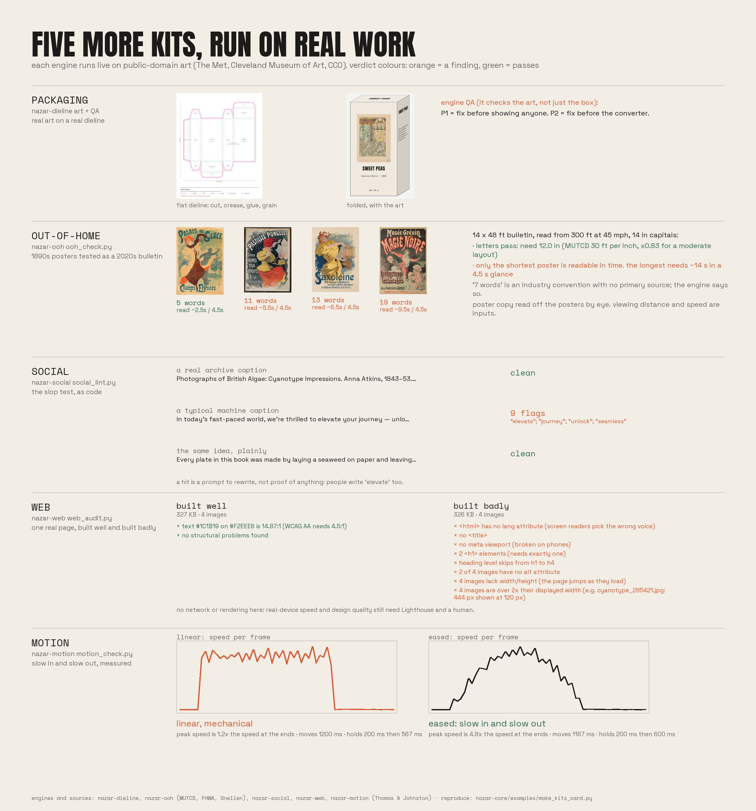

# Results on real work

Every number comes from an engine run on real, public-domain material (or, for the case study, a real brand archive). Back to the [README](../README.md).

## The engine results, in order of importance

These first cards test the engines on real, public-domain material, not a full run with prompts: the case study above does that. Each card below is a real engine run, with its headline number and what that number means. The independent results come first; the group of five engines comes last.

### 1. Can the engines tell designers apart?

> **The result:** 60% of 35 real prints attributed to the right maker, blind.
>
> **What it means:** Each designer's measurable habits are learned from the *other* prints, then the engine names the maker of the hidden one. The bar to beat is **37%** (always guessing Steinlen, who has 13 of the 35), not 25% (pure chance). It works for consistent makers (Steinlen 10/13, Chéret 6/9) and fails for Lautrec (2/7), whose work spans three modes. These numbers are only the measurable layer: *why* is the maker's to say.

Hide one print, learn each designer from the rest, name the maker: **60% against 37% for always guessing the biggest group and 25% for chance**, on 35 real CC0 prints. Steinlen (10/13) and Chéret (6/9) have a consistent measurable look. Lautrec (2/7) doesn't: his works span flat-colour posters, a pale line print and a dark black-and-white stage poster, so the engine sees three modes, not one hand. That's the right answer, and it's why the VLM pass and the maker's confirmation exist. Credits are in [`cma_credits.json`](../nazar-voiceprint/examples/cma_credits.json). Every print was reviewed by eye, and `fetch_cma_designers.py` uses an approved allowlist so nothing unreviewed can slip in.

### 2. Real photographs, read blind

> **The result:** 24 public-domain photographs graded by the engine, which never saw the label (each object's own catalogue record).
>
> **What it means:** All 10 cyanotypes read as one blue hue (about 238°); albumen and salted paper read as warm-toned prints (about 67–69°) but can't be told apart; autochrome is only partly read. It reads the *look*, not the chemistry, and says so.

24 public-domain (CC0) photographs from The Met, grouped by the process **each object's own catalogue record names**, and the engine never sees that label. Cyanotypes come out blue, single-hue and soft; albumen and salted paper come out as warm-toned prints. It can't separate albumen from salted paper, and autochrome grain needs full-resolution scans; the card says so. A blue image on warm paper is never labelled "teal & orange": that name needs a genuinely multi-hue grade. Credits for every image are in [`met_credits.json`](../nazar-voiceprint/examples/met_credits.json). Every photo was checked by eye before use, and `fetch_met.py` paces its requests and backs off when rate-limited.

### 3. Type QA on real fonts, including real Urdu

> **The result:** 4 real fonts checked: none of the studio's 3 fonts has the ₨ sign, and Gulzar covers only 4 of 15 Sindhi letters.
>
> **What it means:** Coverage is the share of the characters a job needs that the font actually contains; a missing one prints as an empty box. 1.2 mm is the EU minimum x-height for small print (Art. 13): Gulzar needs **7.7 pt** to reach it, Anton only **4.6 pt**.

`nazar-type/engine/type_check.py` runs the type kit's own checklist on real font files: licence and embedding as the file declares them, coverage per script (Latin, transliteration, pack symbols, Urdu, Sindhi, Devanagari), whether the Arabic-script shaping features exist, kerning, and the **smallest size at which the x-height reaches the 1.2 mm EU rule**. Then a real shaped Urdu line goes through each font, so you can *see* what coverage means. It found real things: none of the studio's own fonts has the **₨ sign**; **Gulzar** sets Urdu beautifully but covers only 4 of 15 Sindhi letters, and needs 7.7 pt for a legal x-height against 4.6 pt for Anton; and Gulzar's file doesn't carry its licence text, so the OFL file from its repository must be filed beside it (confirmed from the source: OFL 1.1). Coverage % says nothing about whether the shapes are good, and the card says so.

### 4. A palette from real archive work, then checked

> **The result:** 10 cyanotypes become a 5-colour palette in which only 1 of 10 colour pairs can carry body text.
>
> **What it means:** WCAG contrast of **4.5:1** is the minimum for body text, 3:1 for large text and UI. Real archive colour is often too narrow to carry type, which is exactly why a palette is checked before it becomes a brand.

`nazar-colour/engine/palette_check.py` does what the colour kit promises: archive images in, palette out (k-means in OKLab), then every pair checked.

- **Contrast:** WCAG 2 ratios, with a verdict per pair. The maths is verified against published values (black on white is 21:1; `#777` on white is 4.48:1, the classic near-miss).
- **Colour-blind:** protan, deutan and tritan simulation (Machado, Oliveira & Fernandes 2009); flags any pair that collapses for a viewer.
- **Greyscale:** pairs that depend on hue alone.
- **Honest on APCA:** deliberately not used, because its place in WCAG 3 is unresolved as of April 2026.

Real archive colour is often *worse* than a designed palette: in this one, only 1 of 10 pairs carries body text. That's the finding, not a flaw, and it's why the kit checks before it ships.

### 5. Archive colour → brand tokens → backdrops

> **The result:** the accent is 4.92:1 on the dark ground and 1.02:1 on the light one, so light mode is refused and 5 dark backdrops are built.
>
> **What it means:** 1.02:1 is invisible. The backdrops engine refuses a mode whose accent can't be seen (under 2:1) and warns under 3:1, so a palette that only supports a dark set gets a dark set and says why.

Three kits chained on real work: ten CC0 cyanotypes → `nazar-colour` → `nazar-backdrops`. Brand roles are assigned **by contrast, not list order** (`derive_tokens`): the small-text colour must reach 4.5:1 on its ground, and the engine says so when a palette is too narrow for it. A mode is skipped when its accent is invisible. This archive supports a dark set only. The mark is the example brand's placeholder, left unaltered on purpose: **client logos are never recoloured or redrawn**.

### 6. Etching → vector

> **The result:** one Rembrandt etching (public domain) becomes 562 shapes and 5,908 nodes with `--fine`.
>
> **What it means:** A node is one anchor on a vector curve: fewer nodes mean a cleaner, more editable shape. Plain mode is for bold marker and pencil; `--fine` is for hairlines and engraving.

`nazar-core/engine/trace.py`: **hands first.** Kaif draws, the machine cleans up.

1. **Clean the photo:** flatten the uneven light, threshold it automatically, despeckle.
2. **Find the corners:** checked at two scales, and pinned so smoothing can't round them off.
3. **Place nodes on the true extremes,** where the curve is really horizontal or vertical, the way a professional vector artist would.
4. **Fit the curves:** Schneider least-squares Béziers, giving a single SVG path with holes kept.

**Hairlines and engraving: `--fine`.** A global threshold loses lines under ~2 px, so plain mode is for bold marker and pencil. `--fine` upscales, uses a *local* threshold (darker than its own neighbourhood) and skips the despeckle opening step, which keeps an etching's tree, figure and hatching (shown above, CC0 from The Met). It stays noisy in the darkest shadow: raise `--min-area` to drop dust. You get three variants (tight, balanced, smooth), a compare sheet and a node report. `--levels 3` traces shaded drawings into recolourable tone layers for package art. It needs only numpy and Pillow, and it's MIT-clean.

### 7. Dielines, and real art on them

> **The result:** the pack engine's own QA flags problems in the art on a real pack (safe area, contrast, a missing logo file) and passes it clean once they're fixed.
>
> **What it means:** It checks the *art* (safe area, contrast, type size, missing logo files), not just the box. A common one: an image block's `y` is its *centre* unless you set `valign: top`, and the engine flags art that crosses the safe area.

`nazar-dieline/engine/dieline.py`: give it the inside dimensions (L × W × D) and the board, and it draws a **concept dieline**.

- **Formats:** layered SVG, PDF, PNG, a **DXF** that opens in CAD (with CUT / CREASE / PERF / GLUE layers), and a spec sheet.
- **14 structures:** ECMA tuck ends, sleeve, glued tray, FEFCO 0201 / 0200 / 0427, pillow, rigid set-up box (blank plus wrap with turn-ins), cone and wrap labels, stand-up pouch, chips flow-wrap, and a shrink-sleeve map.
- **Spec sheet:** flat size, board area, cut and crease rule length (which drives die cost), rough nesting per sheet, and a McKee compression estimate for corrugated.
- **Engineering:** caliper allowances, friction locks, tapered glue flaps, corner reliefs, and grain arrows.
- **Testing:** every DXF passes a CAD audit with zero errors.

**On a real client system (BAGH):** one master SVG per pack feeds both branches. `nazar-packaging/engine/press_pdf.py` writes the press PDF (composite, one page per ink, cut lines, trim and bleed boxes) and `nazar-dieline/engine/film.py` draws the frosted-film render. 29 packs, 39 press PDFs, one QA gate. Try it on the real master: `python nazar-packaging/engine/press_pdf.py --in "nazar-packaging/examples/*-art.svg" --out out/print --prefix BAGH` gives 6 pages, 140 × 450 mm trim, 3 mm bleed, no fixes to make.

Add an `"art"` block and the engine lays out an **MVP pack**, panel by panel.

- **The right way up when folded.** Tucks, lids and bottoms rotate automatically.
- **Real brand assets:** brand tokens, outlined fonts (harfbuzz), the client's exact logo file, bands, patterns that run across folds, and placeholders for copy and the GS1 barcode at true size.
- **Folded oblique preview** of the pack.
- **Transparency handled for real:**
  - A carton window becomes a die-cut hole plus the film patch.
  - Clear and metallised film get "no ink, no white" windows, a **white-ink plate**, and a preview in the product's own colour.
  - Chips packets get the fin seal, serrated crimps and the back art split across the web.
- **Automatic draft QA:** type size in pt, contrast measured against what's actually behind the text, copy overflow, barcode size and fit, net quantity in the bottom 30% of the principal panel, art on the glue flap, windows too close to creases or seals, and light-sensitive snacks behind windows.
- **Send it to Figma:** `--figma` writes a step-by-step build plan for [claude-talk-to-figma-mcp](https://github.com/arinspunk/claude-talk-to-figma-mcp). Upright panels arrive as editable layers and text, and the dieline as a locked layer. The setup guide covers a pinned, localhost-only install for any user's Claude: [`nazar-dieline/FIGMA.md`](../nazar-dieline/FIGMA.md).

### 8. Five more engines: packaging QA, billboards, social, web, motion

Five kits, each with its own small engine built on sources and run on real public-domain art. What each result means:

| Kit | The real result | What it means |
|---|---|---|
| **Packaging** | QA flags 3 problems on a real pack; clean once fixed | The engine checks the art, not just the box |
| **Billboards** (`ooh_check.py`) | Of four real 1890s posters, only the 5-word one is readable in time (a 4.5 s glance at 45 mph, 300 ft) | Letter height follows the road-sign rule (30 ft of distance per inch, MUTCD). The "7 words" and "6 seconds" rules are **unsourced folklore** and labelled so |
| **Social** (`social_lint.py`) | A machine-style caption: 9 flags. A real archive caption and a plain rewrite: 0 | The slop test as code. A hit is a prompt to rewrite, never proof of anything |
| **Web** (`web_audit.py`) | The same page built well: 0 problems. Built badly: 8 failed checks | Structure, alt text, layout shift, contrast. No real-device speed: that needs Lighthouse |
| **Motion** (`motion_check.py`) | A linear reveal: peak speed 1.2× its end speed. An eased one: 4.8× | Measures *slow in, slow out* (Thomas & Johnston). It measures, it doesn't prescribe durations |

